

# مقدمة عن Google Cloud (EP-01)

**عربي** | [English](README.md)

الـ GCP (اختصار Google Cloud Platform) من أكبر منصات الـ cloud في العالم. شركات startup صغيرة شغالة عليها، وكمان شركات من أكبر الشركات الموجودة.

الجزء ده عن الصورة الكبيرة. هنبدأ بإزاي شبكة Google نفسها شغالة، وبعدين نشوف الـ regions والـ zones، ونعدّي على أنواع الخدمات اللي GCP بتقدمها، وفي الآخر هنمشي مع تطبيق حقيقي بيكبر مع الوقت لحد ما يستخدم أغلب الخدمات دي.

## الأول، يعني إيه cloud؟

أي تطبيق بتستخدمه، سواء كان موقع أو تطبيق موبايل أو لعبة، شغال على servers. والـ server ببساطة كمبيوتر قوي، شغلته إنه يرد على الـ requests.

أي شركة ممكن تشتري servers بتاعتها، وتحطها في مبنى تبعها، وتشيل هم كل حاجة: الكهربا والتبريد والتصليح والتحديثات. ده اسمه *on-premises*. الاختيار التاني إنها تأجّر servers من شركة زي Google، وتستخدمها عن طريق الإنترنت، وتدفع على قد اللي استخدمته بس. وده هو الـ cloud.

إنك يبقى عندك servers بتاعتك شبه إنك تشتري عربية: بتدفع تمنها كله في الأول، وبتصلحها لما تعطل، وبتفضل تصرف عليها حتى وهي راكنة. أما الـ cloud فشبه تطبيقات زي Uber: بتركب لما تحتاج، وبتدفع تمن المشوار بس.

## إزاي Google بتوصّل تطبيقاتها للناس

قبل ما ندخل في Google Cloud، خلينا نبص على Google نفسها. فكّر في Search و Gmail و YouTube و Drive و Maps: إزاي بيفتحوا بالسرعة دي، وانت في أي مكان؟

السر في شبكة خاصة ضخمة بتاعة Google. الشبكة دي واصلة لأكتر من 200 دولة ومنطقة، وكل أماكنها متوصلة ببعض بكابلات fiber سريعة (Google بتقول إن عندها حوالي 10 مليون كيلومتر fiber). والشبكة دي فيها تلات أنواع من الأماكن (data centers و PoPs و edge nodes).

### الـ Data centers

الـ data center مبنى ضخم مليان servers. هنا تطبيقات Google بتشتغل فعلًا، وهنا الـ data بتتخزن. والـ data centers متوصلة ببعض، والمحتوى بيتنسخ عليهم، فغالبًا بيوصلك من أقرب واحد ليك.

  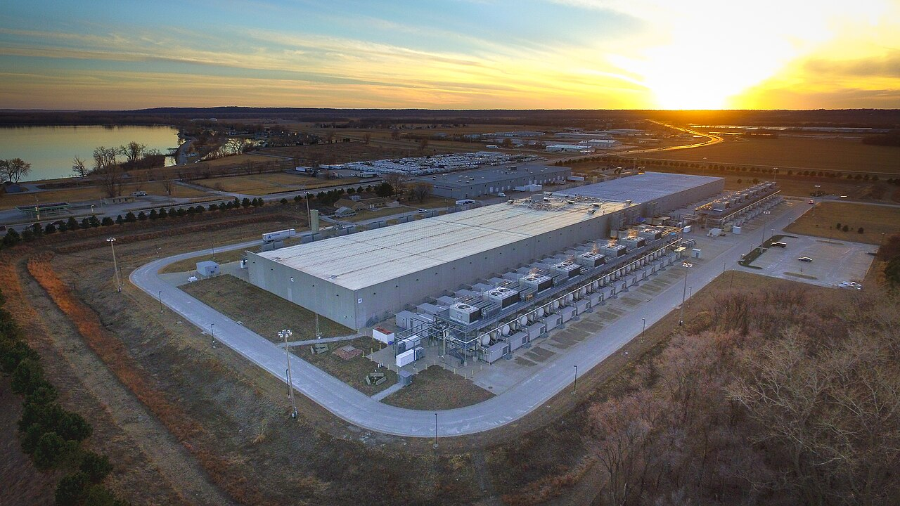
  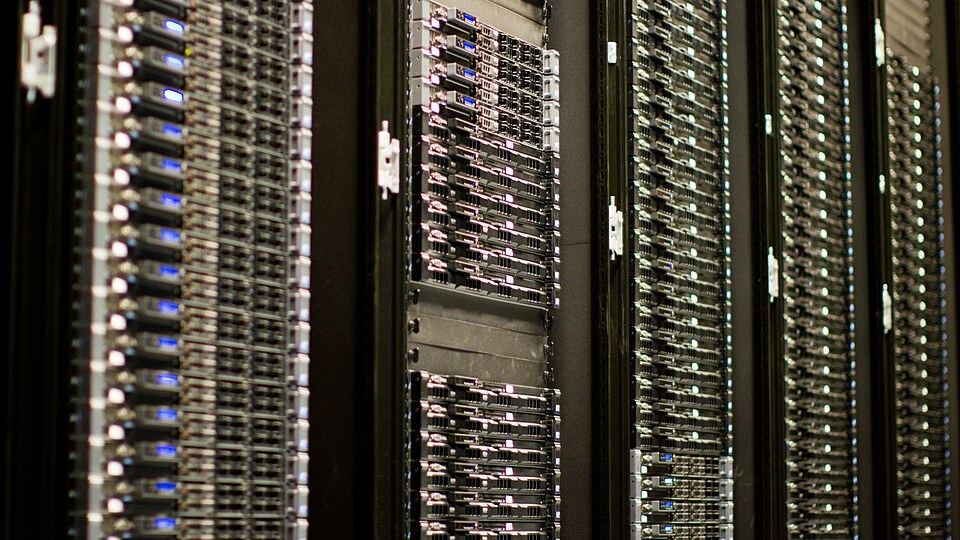

<em>على اليمين: data center تبع Google في كاونسل بلافس بولاية آيوا. وعلى الشمال: شكل الـ data center من جوه، صفوف ورا صفوف من الـ servers.</em>

### الـ Points of Presence (PoPs)

الـ PoP هو المكان اللي شبكة Google بتقابل فيه باقي الإنترنت. الـ ISP بتاعك، يعني الشركة اللي بتدفعلها اشتراك النت، بيتوصل بـ Google عند PoP. والتوصيل المباشر ده بين شبكتين اسمه **peering**.

خلينا نمشي مع request واحد عشان الصورة توضح. لما تفتح Gmail مثلًا:

1. الـ request بيطلع من جهازك للـ ISP بتاعك، زي WE أو Vodafone.
2. الـ ISP بيوصّله لأقرب PoP تبع Google، وده غالبًا بيبقى قريب منك.
3. من عند الـ PoP، الـ request بيكمّل باقي الطريق لحد الـ data center على كابلات Google نفسها، حتى لو الـ data center في بلد تانية.

لو Google معندهاش شبكة خاصة، الـ request كان هيمشي الطريق كله على الإنترنت العام، ويعدّي على شبكات شركات كتير، شبكة ورا شبكة، وكل واحدة فيها زحمتها ومشاكلها. لكن مع شبكة Google، الجزء اللي على الإنترنت العام قصير، من جهازك لحد أقرب PoP بس. والباقي كله على شبكة Google، ومفيش عليها غير الـ traffic بتاع Google، فالـ request بيوصل أسرع.

فكّر فيها كده: الإنترنت العام زي الشوارع العادية اللي فيها زحمة وإشارات، وشبكة Google زي طريق سريع خاص، والـ PoP هو مدخل الطريق ده. الـ ISP بيوصّلك لحد المدخل، ومن هناك بتكمّل على الطريق السريع لحد الـ data center.

### الـ Edge nodes

الـ edge nodes (وبيتقال عليها cache nodes برضه) هي servers تبع Google متحطة قريب جدًا من الناس، وكتير بتبقى جوه شبكة الـ ISP نفسه. وشغلتها إنها تحتفظ بنسخ من المحتوى المشهور. خد مثلًا فيديو على YouTube ملايين بيتفرجوا عليه النهارده: لما تدوس play، الفيديو بيجيلك من edge node قريبة منك بدل data center في قارة تانية، فبيشتغل على طول تقريبًا. والـ servers دي Google بتسميها Google Global Cache (GGC).

ده بينفع مع المحتوى الـ *static*، يعني الحاجات اللي هي هي عند كل الناس، زي الفيديوهات والصور. لكن الـ inbox بتاعك أو نتايج البحث بتاعتك بتختلف من شخص للتاني، فدي لسه بتيجي من الـ data centers.

وده شكل التلاتة مع بعض:

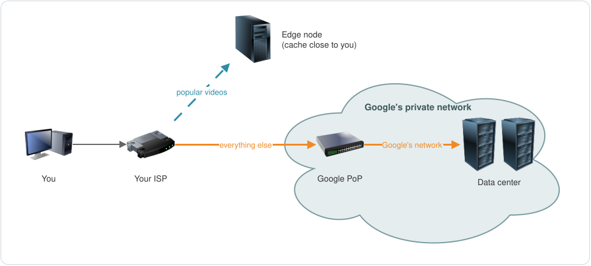

وعشان تفتكرهم بسهولة: الـ data center هو المخزن الرئيسي، والـ PoP هو البوابة اللي بتدخل منها شبكة Google، والـ edge node هو السوبر ماركت الصغير اللي جنب بيتك، اللي بيبقى عنده الحاجات اللي عليها طلب كتير.

## نفس الشبكة بتشغّل Google Cloud

المنتج اللي Google بتبيعه للشركات التانية اسمه Google Cloud، وهو شغال على نفس الشبكة العالمية دي. Google وسّعت الشبكة بـ data centers زيادة في كل حتة في العالم، والـ data centers دي بتشغّل تطبيقات العملاء بدل تطبيقات Google نفسها.

يعني لما تعمل deploy لتطبيق على GCP، الـ traffic بتاعه بيمشي على نفس الشبكة اللي شايلة YouTube و Gmail.

## الـ Regions

الـ data centers بتاعة Google Cloud متجمعة حسب مكانها. ومجموعة الـ data centers اللي في منطقة جغرافية واحدة اسمها **region**، وكل region ليها اسم:

| الـ Region | المكان |
|---:|---:|
| `us-central1` | كاونسل بلافس، ولاية آيوا، أمريكا |
| `us-west2` | لوس أنجلوس، أمريكا |
| `europe-west3` | فرانكفورت، ألمانيا |
| `africa-south1` | جوهانسبرج، جنوب أفريقيا |
| `me-central1` | الدوحة، قطر |
| `me-central2` | الدمام، السعودية |

الاسم بيقولك الـ region موجودة فين تقريبًا. `europe-west3` هي region رقم 3 في غرب أوروبا، و `me` اختصار Middle East يعني الشرق الأوسط. والـ data center اللي في الصورة فوق موجود في كاونسل بلافس، نفس مدينة `us-central1`.

### ليه الـ regions مهمة؟

فيه تلات أسباب أساسية تخليك تهتم بالـ region اللي هتستخدمها.

**السرعة.** كل ما التطبيق يبقى أقرب للمستخدمين، كل ما يحسوا إنه أسرع. الوقت اللي الـ data بتاخده في الطريق اسمه **latency**، وانت عاوزه يبقى قليل. فلو كل عملائك في ألمانيا، هتحط التطبيق والـ data بتاعتك في region في ألمانيا.

**النجاة من الكوارث.** لو التطبيق شغال في اتنين regions، وواحدة منهم جالها زلزال أو عطل كبير، التانية بتكمّل تخدم المستخدمين.

**القانون.** فيه دول عندها قوانين بتحدد الـ data تتخزن فين. في أوروبا مثلًا، قانون GDPR بيحط حدود على إنك تبعت الـ data الشخصية بتاعة الناس برّه أوروبا، فشركات كتير بتخلي الـ data دي في regions أوروبية.

## الـ Zones

دلوقتي خلينا نقرّب على region واحدة. كل region متقسمة لـ **zones**، غالبًا تلاتة (وفيه regions فيها أكتر، زي `us-central1` اللي فيها أربعة). الـ zone عبارة عن data center واحد أو أكتر، واللي بيميزها إن كل zone ليها الكهربا بتاعتها، والتبريد بتاعها، وأجهزة الشبكة بتاعتها. فلو zone الكهربا قطعت عنها، باقي الـ zones اللي في نفس الـ region بتفضل شغالة.

واسم الـ zone هو ببساطة اسم الـ region وبعده حرف:

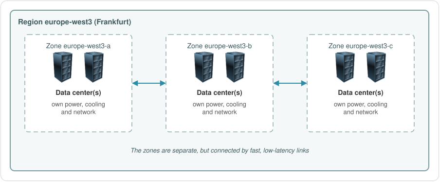

والـ zones اللي في نفس الـ region متوصلة ببعض بوصلات سريعة جدًا والـ latency بتاعتها قليلة، فنسخ التطبيق اللي في zones مختلفة تقدر تكلم بعض بسرعة.

### لما يحصل عطل

ده أهم سبب لوجود الـ zones والـ regions أصلًا. المشاكل بتيجي بحجمين:

- الـ **zone outage** عطل محلي، زي إن الكهربا تقطع في zone واحدة. لو التطبيق شغال في اتنين أو تلات zones في نفس الـ region، المستخدمين مش هياخدوا بالهم أصلًا.
- الـ **region outage** أكبر، زي كارثة طبيعية تضرب منطقة بحالها. وعشان التطبيق يعدّي ده، لازم يبقى شغال في أكتر من region.

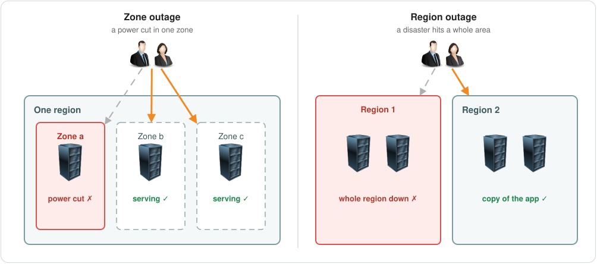

إنك تخلي التطبيق شغال حتى لو جزء منه وقع، ده اسمه **high availability**.

لحد نوفمبر 2026، Google Cloud عنده 43 region و 130 zone، وفيه regions جديدة بتتضاف على طول. وصفحة [Cloud locations](https://cloud.google.com/about/locations) دايمًا فيها القايمة الحالية.

يعني على أرض الواقع الترتيب كده: شبكة Google مغطية العالم، والشبكة متقسمة لـ regions، وكل region متقسمة لـ zones، وكل zone فيها data center واحد أو أكتر.

## الـ resources: global و regional و zonal

أي حاجة بتعملها في Google Cloud، زي virtual machine أو disk أو network، اسمها **resource**. وكل resource ليه scope بيقولك هو واصل لحد فين:

| الـ Scope | تقدر تستخدمه من | أمثلة |
|---:|---:|---:|
| Global | أي region أو zone | الـ VPC networks والـ OS images |
| Regional | أي zone في نفس الـ region | الـ subnets والـ regional static IPs |
| Zonal | نفس الـ zone بس | الـ virtual machines (VMs) والـ disks |

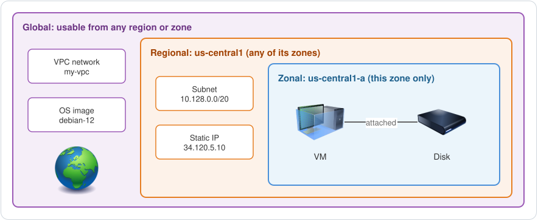

هتقابل الكلام ده أول ما تبدأ تعمل حاجات بنفسك. الـ VM بيطلب منك تختار zone، والـ subnet بيطلب منك تختار region، أما الـ VPC network فهي global، يعني مش تبع أي region خالص.

## الخدمات اللي GCP بتقدمها

في GCP مئات الخدمات، بس كلها بتتقسم لكام مجموعة. مش محتاج تحفظ أسامي المنتجات دلوقتي، المهم دلوقتي المجموعات نفسها.

- الـ **Compute**: الـ servers اللي بتشغّل التطبيق. *(Compute Engine, Cloud Run, Google Kubernetes Engine)*
- الـ **Networking**: بيوصّل الـ servers ببعض وبالإنترنت. *(VPC, Cloud Load Balancing, Cloud CDN, Cloud DNS)*
- الـ **Databases**: بتخزّن معلومات المستخدمين والمنتجات. *(Cloud SQL, Firestore, Spanner, Memorystore)*
- الـ **Object storage**: بيخزّن الملفات زي الـ backups والصور والفيديوهات. *(Cloud Storage)*
- الـ **IAM** (Identity and Access Management): بيحدد مين يقدر يوصل لأنهي خدمة، ومسموح له يعمل إيه فيها.
- الـ **Security**: بيحمي التطبيقات والـ data بتاعتك. *(Cloud KMS للـ encryption keys، و Cloud Armor لحماية الـ web apps)*
- الـ **DevOps**: بيساعد الـ developers يوصّلوا الكود للـ production بسرعة. *(Cloud Build, Artifact Registry, Cloud Deploy)*
- الـ **Management tools**: الـ monitoring والـ logs والـ alerts ومتابعة التكلفة. *(Cloud Monitoring, Cloud Logging, Cloud Billing)*
- الـ **Migration tools**: بتساعدك تنقل لـ Google Cloud التطبيقات والـ data اللي عندك أصلًا. *(Migration Center, Database Migration Service)*
- الـ **Analytics والـ big data والـ ML والـ AI**: بتساعد الـ data engineers والـ data scientists يحللوا الـ data ويطلّعوا منها توقعات. *(BigQuery, Pub/Sub, Dataflow, Gemini Enterprise Agent Platform، اللي كان اسمها Vertex AI)*

وأحسن طريقة تشوف بيها مكان كل واحدة فيهم، إنك تمشي مع تطبيق حقيقي وهو بيكبر.

## تطبيق واحد، من أول يوم لحد ما يبقى عنده مستخدمين كتير

كل ما التطبيق يكبر، بتظهر مشكلة جديدة، وواحدة من المجموعات دي هي اللي بتحلها.

### أول يوم

شركة صغيرة بتبيع منتجات أونلاين. الـ setup أبسط ما يكون: المستخدمين بيوصلوا لـ web server، والـ web server بيكلم app server شايل الـ business logic (الأسعار والطلبات والقواعد)، والـ app server بيقرا ويكتب في database.

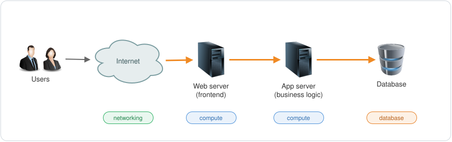

كده عندنا تلات مجموعات من أول يوم: compute للـ servers الاتنين، و networking عشان المستخدمين يوصلوا للـ servers والـ servers توصل لبعض، و database.

### مستخدمين أكتر: الـ scaling

التطبيق بقى مشهور. مستخدمين أكتر يعني requests أكتر، وعند نقطة معينة server واحد مش هيقدر يلاحق. وفيه طريقتين تتعامل بيهم مع ده:

| | بتعمل إيه | اسمها كمان |
|---:|---:|---:|
| الـ Vertical scaling | بتدّي الـ server بتاعك CPU و RAM أكتر | الـ scaling up (أو down) |
| الـ Horizontal scaling | بتزوّد عدد الـ servers | الـ scaling out (أو in) |

الـ vertical scaling زي إنك تبدّل عربيتك بأتوبيس، والـ horizontal scaling زي إنك تجيب عربيات زيادة. في الـ cloud هتشوف الـ horizontal scaling أغلب الوقت: الماكينة الواحدة ليها حد في الكبر، ولما يبقى عندك كذا ماكينة، واحدة فيهم ممكن تقع من غير ما التطبيق يقع معاها.

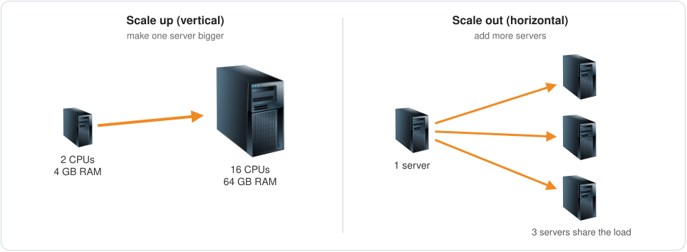

على GCP، الـ Compute Engine يقدر يزوّد ويشيل VMs لوحده حسب الضغط، ودي اسمها autoscaling.

### كذا server: الـ load balancing

دلوقتي بقى عندنا كذا server، وكل واحد ليه الـ IP address بتاعه. طب المستخدم يتصل بأنهي واحد فيهم؟

هنا بييجي دور الـ **load balancer**. المستخدمين بيتصلوا بعنوان واحد، والـ load balancer بيوزّع الـ traffic على الـ servers اللي وراه. وغالبًا بيبقى عندك اتنين: واحد public قدام الإنترنت، وواحد internal بين الـ web servers والـ app servers.

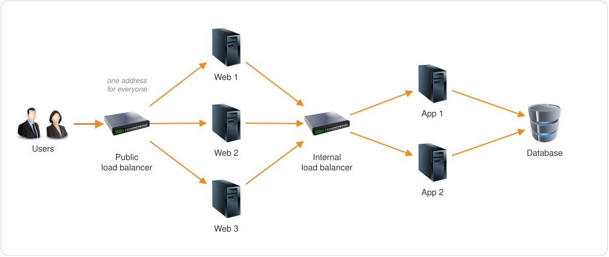

الـ load balancing جزء من الـ networking، واسمه على GCP هو Cloud Load Balancing.

### الـ database بقت بطيئة: الـ replicas والـ caching

مع زيادة الـ app servers، الـ database بقى بيوصلها queries أكتر بكتير. والـ databases بتقرا من الـ disk، وده بطيء، فالـ database بتبدأ تاكل CPU وتاخد وقت أطول عشان ترد.

فيه حاجتين بيساعدوا. الأولى إنك تعمل scaling للـ database نفسها، مثلًا تضيف read replicas، ودي نسخ من الـ database تقدر ترد على الـ read queries. والتانية إنك تحط **cache** قدامها. الـ cache بيحتفظ بالـ data اللي بتتطلب كتير في الـ memory (الـ RAM)، والقراية من الـ RAM أسرع بكتير من القراية من الـ disk.

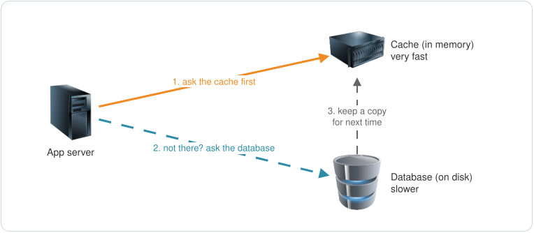

لما تلاقي الـ data في الـ cache ده اسمه **cache hit**، ولما ماتلاقيهاش ده اسمه **cache miss**. وكل ما الـ hits تزيد، الشغل اللي على الـ database بيقل. وخدمة الـ cache الـ managed على GCP اسمها Memorystore.

### الصور والفيديوهات: الـ object storage

صور المنتجات والفيديوهات مكانها مش الـ database. مكانها الـ **object storage**، وهناك كل ملف اسمه object. والـ database بتحتفظ بس بالـ **metadata** بتاعة الملف: اسمه، وحجمه، ومتخزن فين.

فلما حد يفتح صفحة منتج، التطبيق بيجيب تفاصيل المنتج من الـ database، والصورة من الـ object storage:

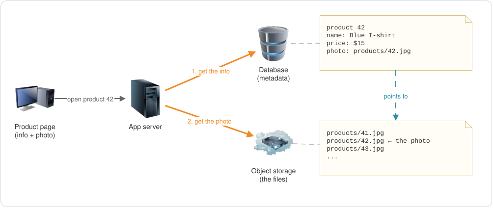

ولو محتاج تعمل processing للملفات دي، زي إنك تغيّر مقاس الصور أو تحوّل الفيديوهات لصيغة تانية، فده compute تاني. والـ object storage على GCP اسمه Cloud Storage.

### الملفات المشهورة: الـ CDN

فيه ملفات بتتطلب تاني وتالت، زي صور المنتجات اللي بتبيع أكتر حاجة. بدل ما تبعتها من الـ storage بتاعك كل مرة، تقدر تعملها cache في edge locations قريبة من المستخدمين. هي نفس فكرة الـ edge nodes بتاعة Google اللي اتكلمنا عنها فوق: أول request بيروح لحد الـ storage بتاعك، وكل request بعده بيتخدم من النسخة القريبة.

ده اسمه **CDN** (Content Delivery Network)، وعلى GCP اسمه Cloud CDN.

  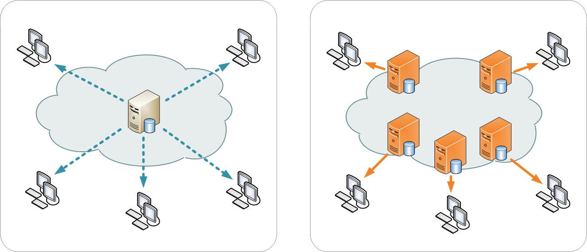

<em>من غير CDN، كل الناس بتحمّل من server واحد (الشمال). ومع الـ CDN، كل واحد بيحمّل من نسخة قريبة منه (اليمين).</em>

### كل الـ data دي: الـ analytics والـ ML

دلوقتي التطبيق بيطلّع live data كتير: زيارات، و clicks، وعمليات بحث، وطلبات. والـ data دي قيمتها كبيرة. الـ **data pipeline** بيجمعها وينقلها لـ **data lake**، ومعاها data جاية من مصادر تانية. الـ data engineers والـ data scientists بيحللوها، وموديلات الـ machine learning بتستخدمها عشان تتوقع العملاء هيعوزوا إيه.

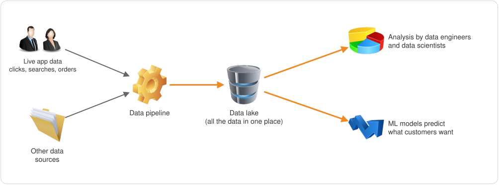

على GCP، ده Pub/Sub و Dataflow للـ pipeline، و BigQuery للتحليل، و Gemini Enterprise Agent Platform للـ ML.

### الحاجات اللي بتغطي كل حاجة

فيه مجموعات مالهاش مكان واحد، دي بتنطبق على التطبيق كله:

- الـ **Security** في كل طبقة، من الشبكة لحد التطبيق. والـ data لازم تبقى متشفرة *at rest* (وهي متخزنة) و *in transit* (وهي بتتنقل بين الأجزاء).
- الـ **IAM**، عشان تتحكم مين يقدر يوصل لكل جزء، ويعمل فيه إيه.
- الـ **Monitoring والـ alerts**، عشان تعرف إن كل حاجة شغالة كويس، ويجيلك تنبيه أول ما حاجة تبوظ.
- أدوات الـ **DevOps** والـ automation، عشان الـ developers ينزّلوا versions جديدة على الـ production بسرعة ومن غير قلق.
- الـ **Cost management**. الشركة عاملة التطبيق ده عشان تكسب فلوس، فلازم تعرف كل جزء بيكلّف كام، وماتدفعش في حاجات مش بتستخدمها. والـ billing reports والـ budget alerts بتوع GCP بيساعدوا في ده.

### الصورة كاملة

الأسهم البرتقاني بتمشي مع الـ request العادي جوه التطبيق. والخط الأزرق المتقطع هو طريق الـ CDN: الملفات المشهورة بتوصل للمستخدمين من نسخة قريبة منهم، من غير ما تعدّي على الـ servers بتاعتك خالص.

## الخلاصة

- عند Google شبكة عالمية خاصة بيها، فيها data centers و PoPs و edge nodes.
- نفس الشبكة دي بيشتغل عليها Google Cloud، في data centers بتشغّل تطبيقات العملاء.
- الـ region مجموعة data centers في منطقة واحدة. بتختارها حسب المستخدمين بتوعك فين، وهتعدّي الكوارث إزاي، والقانون بيقول إيه.
- الـ zone جزء معزول من الـ region، ليه الكهربا والتبريد والشبكة بتوعه. كذا zone بيحموك من الأعطال المحلية، وكذا region بيحموك من الأعطال الأكبر.
- أي resource يا global، يا regional، يا zonal.
- خدمات GCP متقسمة لمجموعات: compute و networking و databases و object storage و IAM و security و DevOps و management و migration و analytics/ML/AI.
- كل ما التطبيق يكبر بيحتاج scaling و load balancing و caching و object storage و CDN و data analytics، وحوالين كل ده security و IAM و monitoring و DevOps والتحكم في التكلفة.

## اختبر نفسك

1. إيه هي التلات أنواع من الأماكن في شبكة Google، وكل نوع بيعمل إيه؟
2. إيه الفرق بين الـ region والـ zone؟
3. كل عملائك في ألمانيا. هتختار أنهي region، وليه؟
4. ليه تشغّل التطبيق في اتنين zones بدل zone واحدة؟
5. الـ VM ده global ولا regional ولا zonal؟ وطب الـ VPC network، والـ subnet؟
6. إيه الفرق بين الـ scaling up والـ scaling out؟
7. ليه نحط cache قدام الـ database؟
8. منتج ليه صورة. إيه اللي يتحط في الـ database، وإيه اللي يتحط في الـ object storage؟

الإجابات

1. الـ data centers بتشغّل التطبيقات وبتخزّن الـ data. الـ PoPs هي الأماكن اللي شبكة Google بتتوصل فيها بالـ ISPs (الـ peering). والـ edge nodes بتحتفظ بنسخ من المحتوى المشهور قريب من المستخدمين.
2. الـ region منطقة جغرافية فيها مجموعة data centers، زي `europe-west3` في فرانكفورت. والـ zone جزء معزول من الـ region، ليه الكهربا والتبريد والشبكة بتوعه، زي `europe-west3-a`.
3. أي region في ألمانيا، زي `europe-west3` في فرانكفورت. لأنها الأقرب للمستخدمين، فالـ latency هتبقى أقل، والـ data هتفضل جوه أوروبا.
4. الـ zones بتقع كل واحدة لوحدها. فلو واحدة وقعت، نسخة التطبيق اللي في الـ zone التانية بتخليه شغال.
5. الـ VM ده zonal، والـ VPC network هي global، والـ subnet ده regional.
6. الـ scaling up بيكبّر server واحد، والـ scaling out بيزوّد عدد الـ servers.
7. عشان الـ data اللي بتتطلب كتير تيجي من الـ RAM بدل الـ disk بتاع الـ database، ودي أسرع بكتير، وكمان الـ database يوصلها queries أقل.
8. الـ database بتحتفظ بالـ metadata (الاسم، والسعر، ومكان الصورة)، والـ object storage بيحتفظ بملف الصورة نفسه.

## الجاي

الجزء الجاي (EP-02) عن الـ accounts والـ projects والـ APIs.

---

روابط مفيدة: [قايمة الـ regions والـ zones الحالية](https://cloud.google.com/about/locations) · [شرح الـ regions والـ zones](https://docs.cloud.google.com/compute/docs/regions-zones) · [الـ resources الـ global والـ regional والـ zonal](https://docs.cloud.google.com/compute/docs/regions-zones/global-regional-zonal-resources) · [شبكة Google الـ edge](https://peering.google.com/)

الصور من Wikimedia Commons: [صورة data center تبع Google في كاونسل بلافس](https://commons.wikimedia.org/wiki/File:Google_Data_Center,_Council_Bluffs_Iowa_%2849062863796%29.jpg) تصوير Chad Davis (CC BY 2.0) · [صورة الـ server racks](https://commons.wikimedia.org/wiki/File:Wikimedia_Foundation_Servers-8055_35.jpg) تصوير Victor Grigas (CC BY-SA 3.0، ومتقصوصة) · [رسمة server واحد مقابل CDN](https://commons.wikimedia.org/wiki/File:NCDN_-_CDN.png) من تصميم Kanoha (CC BY-SA 3.0)

