# EP-01: Introduction to Google Cloud

**English** | [عربي](README.ar.md)

GCP (Google Cloud Platform) is one of the biggest cloud platforms in the world. Small startups run on it, and so do some of the largest companies out there.

This first part is about the big picture. We'll start with how Google's own network works, then look at regions and zones, go through the kinds of services GCP offers, and finish with an example of a real app that grows over time and ends up using most of those services.

## First, what is "the cloud"?

Every app you use, whether it's a website, a mobile app or a game, runs on servers. A server is just a powerful computer whose job is to answer requests.

A company can buy its own servers, keep them in its own building, and take care of everything: power, cooling, repairs, upgrades. This is called *on-premises*. The other option is to rent servers from a provider like Google, use them over the internet, and pay only for what you use. That's the cloud.

Owning servers is a bit like owning a car. You pay for it up front, you fix it when it breaks, and you keep paying for it even when it's parked. Using the cloud is more like a ride-hailing app: you ride when you need to and pay for the trip.

## How Google delivers its own apps

Before getting to Google Cloud, it helps to look at Google itself. Think about Search, Gmail, YouTube, Drive and Maps. How do they load so fast, wherever you are?

The answer is a huge private network that Google owns. It reaches more than 200 countries and territories, and all of its locations are connected by fast fiber links (Google says around 10 million kilometers of fiber). There are three kinds of locations in this network (data centers, PoPs and edge nodes).

### Data centers

A data center is a huge building full of servers. This is where Google's apps actually run and where the data is stored. The data centers are connected to each other, and content is copied across them, so you usually get it from the one closest to you.

  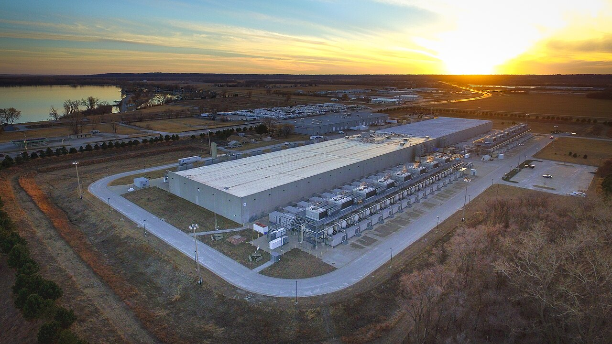
  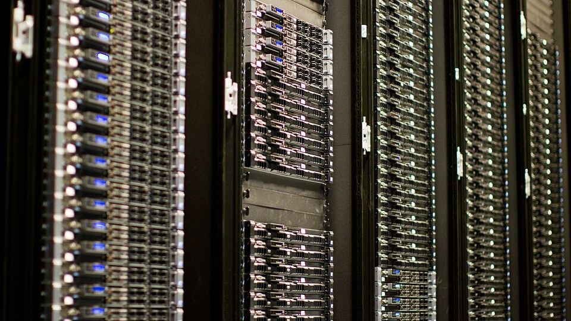

<em>A Google data center in Council Bluffs, Iowa (left), and what the inside of a data center looks like: rows and rows of servers (right).</em>

### Points of Presence (PoPs)

A PoP is where Google's network meets the rest of the internet. Your ISP, the company you pay for internet, connects to Google at a PoP. This kind of direct connection between two networks is called **peering**.

It's easier to see with a single request. Say you open Gmail:

1. The request leaves your device and goes to your ISP.
2. Your ISP hands it to the nearest Google PoP, which is usually not far from you.
3. From the PoP, the request travels the rest of the way to the data center on Google's own cables, even if the data center is in another country.

If Google didn't have its own network, the request would travel the whole way over the public internet, passing through the networks of many different companies, each with its own traffic and problems. With Google's network, the public part of the trip is short: only from you to the nearest PoP. Everything after that is on Google's network, which only carries Google's traffic, so the request gets there faster.

Think of it this way: the public internet is like regular streets with traffic and stoplights, and Google's network is a private highway. The PoP is the on-ramp. Your ISP takes you to the on-ramp, and from there you stay on the highway all the way to the data center.

### Edge nodes

Edge nodes (also called cache nodes) are Google servers placed very close to users, often inside the ISP's own network. They keep copies of popular content. Take a YouTube video that millions of people are watching today: when you press play, it comes from an edge node near you instead of a data center on another continent, so it starts almost instantly. Google calls these servers Google Global Cache (GGC).

This works for *static* content, things that are the same for everyone, like videos and images. Your inbox or your search results are different for every person, so those still come from the data centers.

Here's how the three fit together:

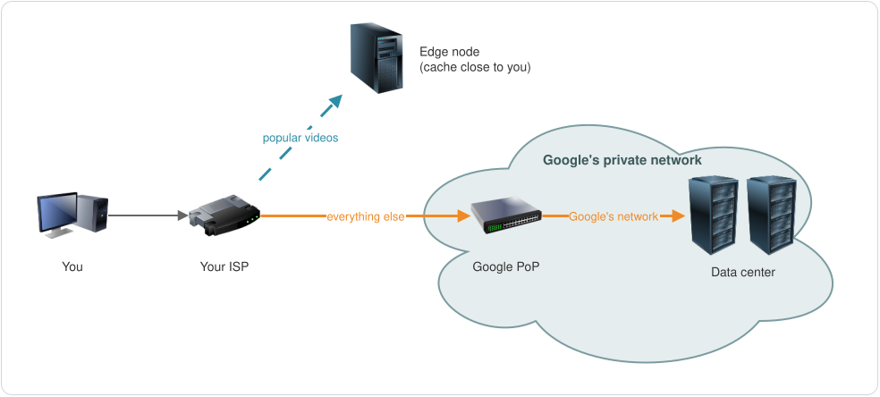

An easy way to remember them: the data center is the main warehouse, the PoP is the gate into Google's network, and the edge node is the small shop near your house that keeps the most popular items in stock.

## Google Cloud runs on the same network

Google Cloud is the product Google sells to other companies, and it runs on that same global network. Google extended the network with more data centers around the world, and these data centers run customers' apps instead of Google's own.

So when you deploy an app on GCP, it travels over the same network that carries YouTube and Gmail.

## Regions

Google groups its cloud data centers by location. A group of data centers in one geographic area is called a **region**, and every region has a name:

| Region | Location |
|---|---|
| `us-central1` | Council Bluffs, Iowa, USA |
| `us-west2` | Los Angeles, USA |
| `europe-west3` | Frankfurt, Germany |
| `africa-south1` | Johannesburg, South Africa |
| `me-central1` | Doha, Qatar |
| `me-central2` | Dammam, Saudi Arabia |

The name tells you roughly where the region is. `europe-west3` is region number 3 in western Europe, and `me` stands for Middle East. (The data center in the photo above is in Council Bluffs, the same city as `us-central1`.)

### Why regions?

There are three main reasons to care about which region you use.

**Speed.** The closer your app is to your users, the faster it feels. The time data takes to travel is called **latency**, and you want it low. If all your customers are in Germany, you put your app and your data in a German region.

**Surviving disasters.** If your app runs in two regions and one of them is hit by an earthquake or a major outage, the other one keeps serving your users.

**The law.** Some countries have rules about where data can be stored. In Europe, GDPR limits sending people's personal data outside Europe, so many companies keep that data in European regions.

## Zones

Now zoom into a single region. Each region is split into **zones**, usually three (some have more, `us-central1` has four). A zone is made of one or more data centers, and what makes it special is that each zone has its own power, its own cooling and its own network equipment. If one zone loses power, the other zones in the region keep running.

Zone names are just the region name plus a letter:

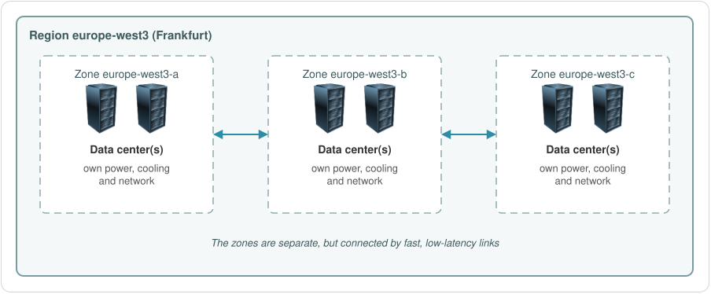

The zones in a region are connected by very fast links with low latency, so copies of your app in different zones can talk to each other quickly.

### When something breaks

This is the real reason zones and regions exist. Problems come in two sizes:

- A **zone outage** is local, like a power cut in one zone. If your app runs in two or three zones of the same region, users won't even notice.
- A **region outage** is bigger, like a natural disaster that takes out a whole area. To survive that, your app needs to run in more than one region.

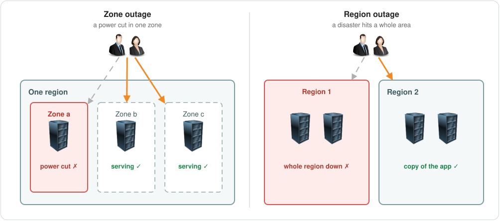

Keeping an app running even when part of the system fails is called **high availability**.

As of November 2026, Google Cloud has 43 regions and 130 zones, and new regions keep being added. The [Cloud locations page](https://cloud.google.com/about/locations) always has the current list.

So the physical side looks like this: Google's network covers the world, the network is divided into regions, each region into zones, and each zone into one or more data centers.

## Global, regional and zonal resources

Everything you create in Google Cloud, like a virtual machine, a disk or a network, is called a **resource**. Every resource has a scope that tells you how far it reaches:

| Scope | Can be used from | Examples |
|---|---|---|
| Global | any region or zone | VPC networks, OS images |
| Regional | any zone in the same region | subnets, regional static IPs |
| Zonal | the same zone only | virtual machines (VMs), disks |

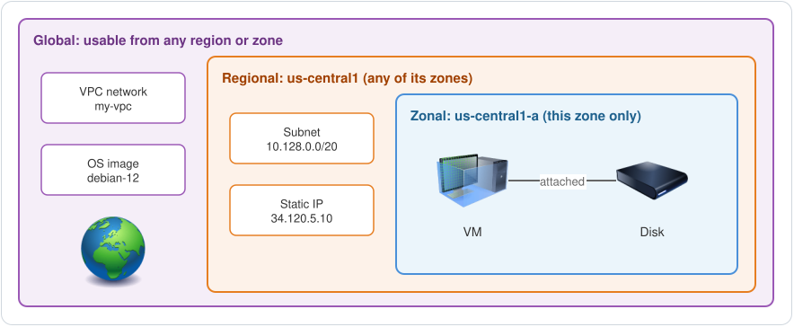

You'll run into this as soon as you start creating things. A VM asks you to pick a zone, a subnet asks you to pick a region, and a VPC network is global, so it doesn't belong to any region at all.

## What GCP offers

GCP has hundreds of services, but they fall into a handful of categories. You don't need to memorize the product names yet. The categories are what matter for now.

- **Compute**: the servers that run your app. *(Compute Engine, Cloud Run, Google Kubernetes Engine)*
- **Networking**: connects your servers to each other and to the internet. *(VPC, Cloud Load Balancing, Cloud CDN, Cloud DNS)*
- **Databases**: store information about your users and products. *(Cloud SQL, Firestore, Spanner, Memorystore)*
- **Object storage**: stores files such as images, videos and backups. *(Cloud Storage)*
- **IAM** (Identity and Access Management): decides who can access which service, and what they're allowed to do with it.
- **Security**: keeps your apps and data safe. *(Cloud KMS for encryption keys, Cloud Armor for protecting web apps)*
- **DevOps**: helps developers get code into production quickly. *(Cloud Build, Artifact Registry, Cloud Deploy)*
- **Management tools**: monitoring, logs, alerts and cost tracking. *(Cloud Monitoring, Cloud Logging, Cloud Billing)*
- **Migration tools**: help you move existing apps and data into Google Cloud. *(Migration Center, Database Migration Service)*
- **Analytics, big data, ML and AI**: help data engineers and data scientists analyze data and make predictions. *(BigQuery, Pub/Sub, Dataflow, Gemini Enterprise Agent Platform, formerly Vertex AI)*

The best way to see where each one fits is to follow a real app as it grows.

## One app, from day one to lots of users

Every time the app grows, a new problem shows up, and one of these categories solves it.

### Day one

A small company sells products online. The setup is as simple as it gets: users reach a web server, the web server talks to an app server that holds the business logic (prices, orders, rules), and the app server reads and writes to a database.

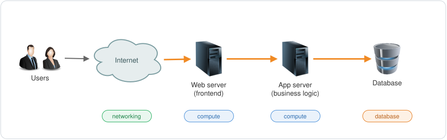

That's already three categories: compute for the two servers, networking so users can reach the servers and the servers can reach each other, and a database.

### More users: scaling

The app gets popular. More users means more requests, and at some point one server can't keep up. There are two ways to handle that:

| | What you do | Also called |
|---|---|---|
| Vertical scaling | give the server more CPU and RAM | scaling up (or down) |
| Horizontal scaling | add more servers | scaling out (or in) |

Vertical scaling is like swapping your car for a bus. Horizontal scaling is like adding more cars. In the cloud you'll mostly see horizontal scaling: one machine can only get so big, and having several machines means one of them can fail without taking the app down.

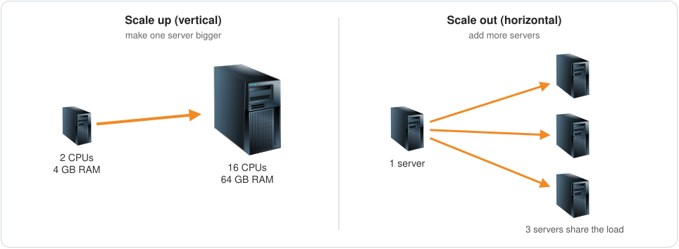

On GCP, Compute Engine can add and remove VMs for you based on load. This is called autoscaling.

### Many servers: load balancing

Now there are several servers, and each one has its own IP address. Which one should a user connect to?

That's the job of a **load balancer**. Users connect to one address, and the load balancer spreads the traffic across the servers behind it. You usually end up with two: a public one that faces the internet, and an internal one between the web servers and the app servers.

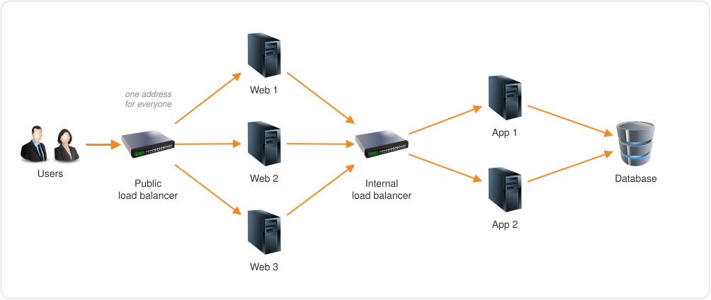

Load balancing is part of networking. On GCP it's called Cloud Load Balancing.

### A slow database: replicas and caching

With more app servers, the database is getting a lot more queries. Databases read from disk, which is slow, so the database starts eating CPU and taking longer to answer.

Two things help. The first is scaling the database itself, for example by adding read replicas, which are copies of the database that can answer read queries. The second is putting a **cache** in front of it. A cache keeps frequently requested data in memory (RAM), and reading from RAM is much faster than reading from disk.

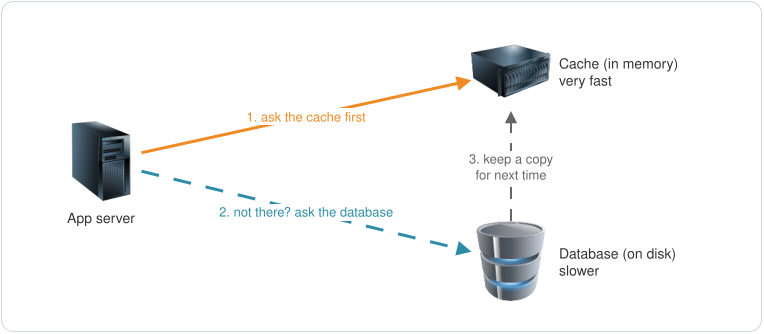

Finding the data in the cache is called a **cache hit**, and not finding it is a **cache miss**. The more hits you get, the less work is left for the database. On GCP, the managed cache service is Memorystore.

### Photos and videos: object storage

Product photos and videos don't belong in the database. They go in **object storage**, where each file is called an object. The database only keeps the file's **metadata**: its name, its size and where it's stored.

So when someone opens a product page, the app gets the product details from the database and the photo from object storage:

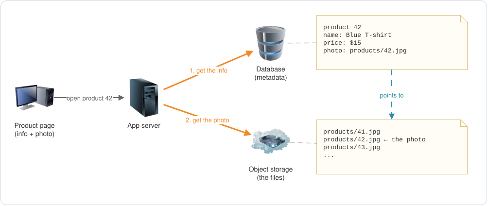

If you need to process those files, like resizing images or converting videos, that's compute again. On GCP, object storage is Cloud Storage.

### Popular files: CDN

Some files get requested over and over, like the photos of your best-selling products. Instead of serving them from your storage every single time, you can cache them at edge locations close to your users. It's the same idea as Google's edge nodes from earlier: the first request goes all the way to your storage, and every request after that is served from the nearby copy.

This is called a **CDN** (Content Delivery Network). On GCP it's Cloud CDN.

  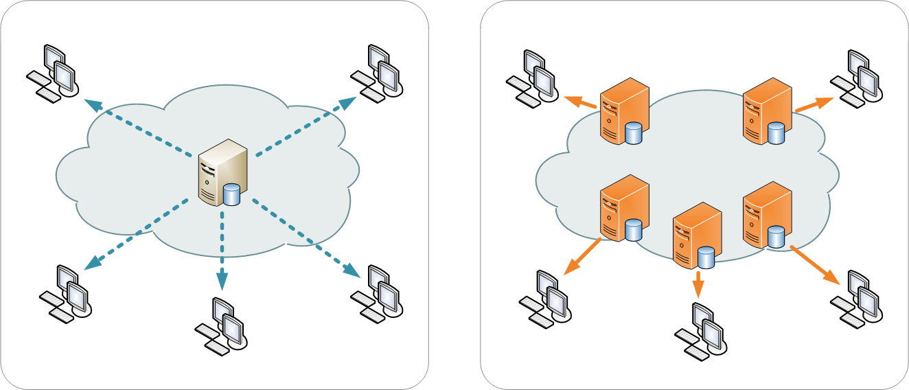

<em>Without a CDN, everyone downloads from one server (left). With a CDN, users download from a copy close to them (right).</em>

### All that data: analytics and ML

By now the app is producing a lot of live data: visits, clicks, searches, orders. That data is worth a lot. A **data pipeline** collects it and moves it into a **data lake**, together with data from other sources. Data engineers and data scientists analyze it, and machine learning models use it to predict what customers will want.

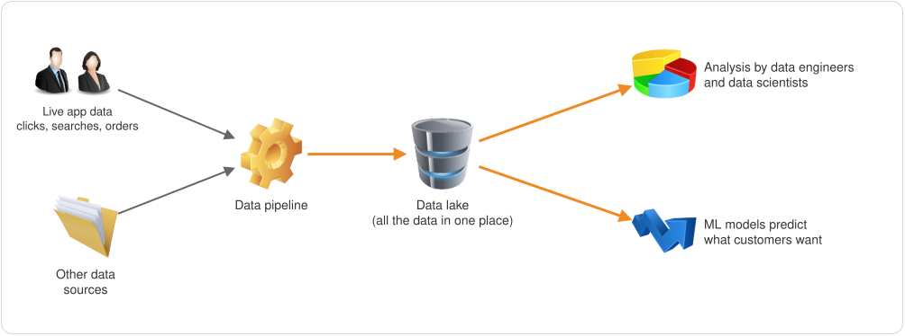

On GCP that's Pub/Sub and Dataflow for the pipeline, BigQuery for analysis, and Gemini Enterprise Agent Platform for ML.

### The things that cover everything

Some categories don't sit in one spot. They apply to the whole app:

- **Security** at every layer, from the network to the app. Data should be encrypted *at rest* (when it's stored) and *in transit* (when it moves between components).
- **IAM**, to control who can access each component and what they can do with it.
- **Monitoring and alerts**, so you know the system is healthy and get warned the moment something breaks.
- **DevOps** tools and automation, so developers can ship new versions to production quickly and safely.
- **Cost management.** The company built this app to make money, so it needs to know what each component costs and avoid paying for things it doesn't use. GCP's billing reports and budget alerts help with that.

### The full picture

The orange arrows follow a normal request through the app. The dashed blue line is the CDN path: popular files reach users from a nearby copy, without going through your servers at all.

## Recap

- Google has a private global network made of data centers, PoPs and edge nodes.
- Google Cloud runs on the same network, in data centers that host customers' apps.
- A region is a group of data centers in one area. You choose it based on where your users are, how you'll survive a disaster, and what the law requires.
- A zone is an isolated part of a region with its own power, cooling and network. Several zones protect you from local outages, several regions protect you from bigger ones.
- Every resource is global, regional or zonal.
- GCP services fall into categories: compute, networking, databases, object storage, IAM, security, DevOps, management, migration, and analytics/ML/AI.
- As an app grows it needs scaling, load balancing, caching, object storage, a CDN and data analytics, with security, IAM, monitoring, DevOps and cost control around all of it.

## Test yourself

1. What are the three types of locations in Google's network, and what does each one do?
2. What's the difference between a region and a zone?
3. All your customers are in Germany. Which region would you pick, and why?
4. Why run your app in two zones instead of one?
5. Is a VM global, regional or zonal? What about a VPC network, or a subnet?
6. What's the difference between scaling up and scaling out?
7. Why put a cache in front of a database?
8. A product has a photo. What goes in the database, and what goes in object storage?

Answers

1. Data centers run the apps and store the data. PoPs are where Google's network connects to ISPs (peering). Edge nodes keep copies of popular content close to users.
2. A region is a geographic area with a group of data centers, like `europe-west3` in Frankfurt. A zone is an isolated part of a region with its own power, cooling and network, like `europe-west3-a`.
3. A German region such as `europe-west3` (Frankfurt). It's closest to your users, so latency is lower, and the data stays in Europe.
4. Zones fail independently. If one goes down, the copy of your app in the other zone keeps it running.
5. A VM is zonal, a VPC network is global, and a subnet is regional.
6. Scaling up makes one server bigger. Scaling out adds more servers.
7. Frequently requested data comes from RAM instead of the database's disk, which is much faster, and the database gets fewer queries.
8. The database keeps the metadata (name, price, where the photo is). Object storage keeps the photo file itself.

## Next

EP-02: accounts, projects and APIs.

---

Useful links: [Cloud locations](https://cloud.google.com/about/locations) · [Regions and zones](https://docs.cloud.google.com/compute/docs/regions-zones) · [Global, regional and zonal resources](https://docs.cloud.google.com/compute/docs/regions-zones/global-regional-zonal-resources) · [Google's edge network](https://peering.google.com/)

Images from Wikimedia Commons: [Google data center in Council Bluffs](https://commons.wikimedia.org/wiki/File:Google_Data_Center,_Council_Bluffs_Iowa_%2849062863796%29.jpg) by Chad Davis (CC BY 2.0) · [server racks](https://commons.wikimedia.org/wiki/File:Wikimedia_Foundation_Servers-8055_35.jpg) by Victor Grigas (CC BY-SA 3.0, cropped) · [single server vs. CDN](https://commons.wikimedia.org/wiki/File:NCDN_-_CDN.png) by Kanoha (CC BY-SA 3.0)
