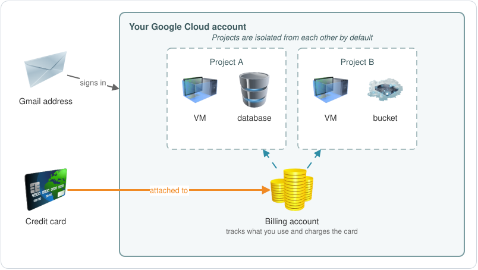
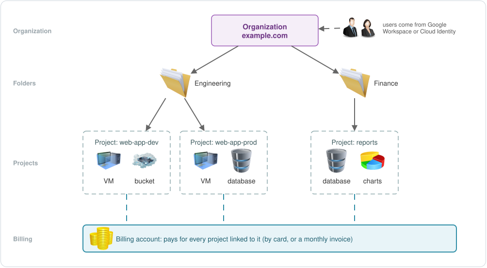
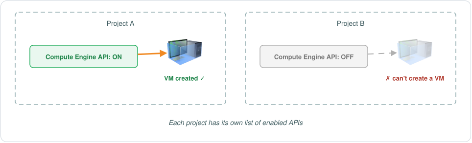
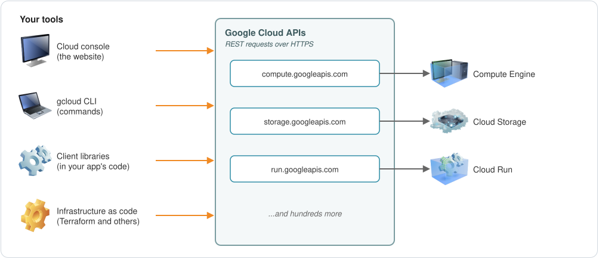
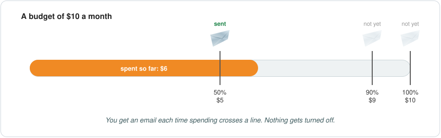

<div dir="rtl" lang="ar">

# الـ Accounts والـ Projects والـ APIs (EP-02)

**عربي** | [English](README.md)

في EP-01 اتكلمنا عن الصورة الكبيرة: شبكة Google، والـ regions والـ zones، وأنواع الخدمات اللي GCP بتقدمها. الجزء ده أخف، وفيه شغل عملي أكتر. هنشوف الـ accounts والـ billing والـ projects مركّبين على بعض إزاي، وإزاي بنكلم Google Cloud عن طريق الـ APIs بتاعته. وبعدين هنطبّق بجد: نعمل account، ونحط budget، ونعمل project، ونشغّل API، الأول من الـ console وبعدين من الـ command line.

## مين بيستخدم Google Cloud؟

فيه نوعين من المستخدمين:

- **شخص واحد**: حد بيتعلم، أو حد بيجرب فكرة (proof of concept)، أو freelancer بيعمل projects لعملاء.
- **شركة أو organization**: شركة بتشغّل التطبيقات بتاعتها على Google Cloud.

الاتنين شغالين بنفس الطريقة من جوه، بس الشركات بيبقى عندها كام طبقة زيادة فوق. هنبدأ بالشخص الواحد.

## الـ account بتاعك

عشان تستخدم Google Cloud لوحدك، محتاج **Google Cloud account**، وعشان تعمله محتاج حاجتين: إيميل **Gmail** و **credit card**.

### الـ Billing account

لما بتعمل الـ account، الـ credit card بتاعتك بتتربط بـ **billing account**. ودي الطريقة اللي Google بتتابع بيها انت بتستخدم إيه، وبتحاسبك عليه. وممكن يبقى عندك أكتر من billing account لو محتاج تفصل المدفوعات عن بعض.

### الـ Projects

أول حاجة بتعملها هي الـ **project**. والـ project عبارة عن container للـ resources بتاعتك: أي VM أو disk أو bucket أو database بتعمله، بيعيش جوه project. وممكن يبقى عندك project واحد أو كتير.

لازم كل project يبقى مربوط بـ billing account. من غيره، مش هتقدر تستخدم الخدمات اللي بفلوس جواه، لأن Google لازم تعرف مين اللي هيدفع.

طب ليه شخص واحد يحتاج كذا project؟ يمكن بتجرب أفكار مختلفة، أو انت freelancer عندك كام عميل وعاوز شغل كل عميل منفصل عن التاني. وده بينفع لأن الـ projects معزولة عن بعض by default: الـ resources اللي في project مش بتقدر توصل للـ resources اللي في project تاني، إلا لو انت ظبطت ده بنفسك.



### الاسم والـ ID والرقم

كل project ليه تلات حاجات بتعرّفه:

| | مثال | تقدر تغيره؟ |
|---:|---:|---:|
| الـ Project name | `My Blog` | أيوه، في أي وقت |
| الـ Project ID | `my-blog-482913` | لأ، ثابت للأبد |
| الـ Project number | `512345678901` | لأ، Google هي اللي بتحدده |

الاسم مجرد label للناس. الـ **project ID** هو المهم: هتكتبه في الـ commands وتستخدمه في الكود على طول. لازم يكون من 6 لـ 30 حرف، وفيه حروف lowercase وأرقام و hyphens بس، ويبدأ بحرف. ولازم يكون unique على Google Cloud كله، مش على الـ account بتاعك بس. وأول ما الـ project يتعمل، الـ ID بتاعه مش بيتغير، وحتى لو مسحت الـ project، محدش هيقدر يستخدم الـ ID ده تاني. فيستاهل تفكر فيه كام ثانية.

## الشركات: الـ organizations والـ folders

الشركة بتشتغل بنفس الطريقة، مع كام فرق.

بدل إيميلات Gmail الشخصية، الشركة غالبًا بتستخدم **Google Workspace**. ودي مجموعة أدوات Google للشركات: Gmail على الـ domain بتاع الشركة نفسها، و Drive، و Meet، وحاجات تانية، ومعاهم مكان واحد تدير منه كل المستخدمين والـ data بتاعتهم. والشركة بتربط الـ domain بتاعها، زي `example.com`، بالـ Workspace.

ولو الشركة مش عاوزة كل ده، تقدر تستخدم **Cloud Identity** بداله. ده بيديك إدارة المستخدمين والـ groups اللي Google Cloud محتاجها، من غير Gmail و Drive وباقي التطبيقات.

الفرق الكبير هو الـ **organization**. دي بتبقى فوق خالص، وبتمثل الشركة كلها بالـ domain بتاعها. وتحتها، الشركة بتعمل **folders** وترتبها زي ما هي عاوزة: حسب القسم، أو حسب الفريق، أو حسب الـ environment زي dev و prod. والـ projects بتبقى جوه الـ folders، والـ resources جوه الـ projects.

والـ billing نفس الفكرة: الـ projects بتتربط بـ billing accounts. الشركة تقدر تدفع بالـ credit card برضه، والشركات اللي بتنطبق عليها الشروط تقدر تاخد فاتورة شهرية (monthly invoice) بدل كده.



الشجرة دي اسمها **resource hierarchy**، وهتبقى مهمة جدًا بعدين. مثلًا الـ permissions اللي بتديها على folder بتنطبق على كل الـ projects اللي جواه. هنوصل لده في جزء الـ IAM.

## إزاي بتكلم Google Cloud: الـ APIs

كل خدمة في Google Cloud ليها **API**: مجموعة endpoints البرامج بتكلمها عشان تستخدم الخدمة دي. لو الـ APIs حاجة جديدة عليك، يستاهل تقرا عنها من دلوقتي، لأنك هتقابلها في كل حتة.

الـ Compute Engine، اللي هي خدمة الـ VMs، ليها Compute Engine API على `compute.googleapis.com`. والـ Cloud Storage ليها API خاص بيها على `storage.googleapis.com`. وفيه مئات غيرهم.

أغلب الـ APIs بتاعة Google Cloud هي REST APIs: بتبعت HTTPS request وبيرجعلك JSON. يعني أي تطبيق أو أداة تقدر تبعت HTTP requests تقدر تستخدم Google Cloud. بس عمليًا، هتضطر تتعامل انت مع الـ sign in والـ tokens وتفاصيل الـ requests، وده شغل كتير. وعشان كده Google بتديك أدوات بتعمل ده بدالك.

### شغّل الـ APIs اللي محتاجها

قبل ما تستخدم أي خدمة في project، لازم الـ API بتاعها يبقى **enabled** في الـ project ده. لو الـ project محتاج VMs، بتعمل enable للـ Compute Engine API جواه.

وده لكل project لوحده. لما تعمل enable لـ API في project، ده مش بيشغّله في أي project تاني، والـ project الجديد بيبقى فيه APIs قليلة بس شغالة by default، فبتشغّل اللي انت محتاجه كل مرة.



## أربع طرق تشتغل بيها على Google Cloud

1. الـ **Google Cloud console**: الـ website. أسهل طريقة تتفرج بيها على كل حاجة وتعمل resources بالـ clicks.
2. الـ **gcloud CLI** (Google Cloud CLI): أداة بتشتغل من الـ command line. أي حاجة تعملها من الـ console تقدر تعملها بالـ gcloud. ولأنها commands، تقدر تحطها في Bash أو PowerShell script وتعيد setup كامل في ثواني.
3. الـ **Cloud Client Libraries**: مكتبات للغات زي Python و Java و Go و Node.js. الـ developers بيستخدموها عشان يكلموا خدمات Google Cloud من جوه الكود بتاع التطبيق.
4. الـ **Infrastructure as code (IaC)**: بتوصف الـ infrastructure بتاعتك في ملفات، وأداة بتعملها لك. الـ Terraform هو الأشهر، و Crossplane و Ansible بيشتغلوا مع Google Cloud برضه. الـ DevOps والـ platform engineers بيعتمدوا عليهم لما الـ infrastructure تكبر.

والأربعة في الآخر بيكلموا نفس الـ APIs:



طب تتعلم أنهي واحدة فيهم؟ الأربعة مفيدين، بس المهم إنك تعرف كل واحدة تنفع إمتى. ماتختارش أداة عشان كل الناس بتستخدمها، افهم الأول هي هتفيدك في إيه.

ابدأ بالـ console والـ gcloud، دول الأساس لكل حاجة بعد كده. وعوّد نفسك على الـ gcloud من بدري بدل ما تعتمد على الـ console لوحده، لأن كتابة الـ commands بتوريك الـ resource متكوّن من إيه بالظبط. والـ infrastructure as code هيبقى ليه معنى أكتر بعدين، لما تبدأ تبني حاجات أكبر وعاوز تعملها أسرع.

## الجزء العملي

### 1. اعمل الـ account بتاعك

1. ادخل على [cloud.google.com](https://cloud.google.com) وابدأ الـ free trial.
2. اعمل sign in بإيميل الـ Gmail بتاعك.
3. اختار بلدك، ووافق على الشروط، وكمّل.
4. اختار **Individual** كنوع الـ account، واكتب اسمك وعنوانك.
5. ضيف الـ credit card بتاعتك وابدأ الـ trial.

وكده خلاص، انت جوه. الـ accounts الجديدة بتاخد free trial: **رصيد 300 دولار تستخدمه خلال 90 يوم**. الـ credit card موجودة عشان Google تتأكد إنك شخص حقيقي. ممكن تحجز مبلغ صغير مؤقت عليها، بس مش هتسحب منك فلوس خلال الـ trial، ولما الـ trial يخلص، الـ billing account بتاع الـ trial بيتقفل لوحده. ومش هتدفع حاجة غير لو انت بنفسك عملت upgrade لـ paid account.

### 2. حط budget الأول

قبل ما تعمل أي حاجة، حط budget. هو اللي هينبهك لو سبت حاجة شغالة ونسيتها.

1. في الـ console، افتح **Billing** واختار الـ billing account بتاعك. التكلفة صفر دلوقتي، لأنك لسه ماعملتش حاجة.
2. روح على **Budgets & alerts** ودوس **Create budget**.
3. اديله اسم. سيب الـ time range شهري، والـ scope على كل الـ projects وكل الـ services، عشان يغطي كل حاجة.
4. حط المبلغ، مثلًا 10 دولار في الشهر (بيبقى بعملة الـ billing account بتاعك).
5. ظبط الـ thresholds بتاعة التنبيهات. الـ defaults هي 50% و 90% و 100% من الـ budget، وتقدر تزود غيرهم، زي 80%. وكل threshold ممكن يتحسب على الصرف الفعلي (**actual**، يعني اللي صرفته لحد دلوقتي) أو الصرف المتوقع (**forecasted**، يعني اللي Google متوقعة إنك هتصرفه لحد آخر الشهر).
6. سيب الـ email alerts للـ billing admins والـ users شغالة، ودوس **Finish**.



حاجة مهمة لازم تبقى واضحة: الـ budget ده بيبعت إيميلات بس. مش بيوقف ولا بيبطّأ أي حاجة. لو جالك تنبيه، انت اللي لازم تروح تقفل الحاجات بنفسك.

### 3. اعمل project

1. دوس على الـ project picker اللي فوق في الـ console. ولأنك شخص واحد، هتلاقي **No organization**، وده طبيعي.
2. دوس **New project**.
3. اكتب اسم الـ project. وتحته، Google بتقترح project ID. تقدر تعدّل الـ ID دلوقتي، بس مش بعد ما الـ project يتعمل.
4. دوس **Create**، وبعدين اختار الـ project الجديد من الـ project picker.

كده انت جوه أول project ليك.

### 4. شغّل API

افتح **Compute Engine** في الـ project الجديد. الـ API بتاعه لسه مش enabled، فالـ console هيطلب منك تعمله enable الأول. تقدر تدوس **Enable** من نفس المكان، أو تعملها من الـ API library:

1. روح على **APIs & Services** > **Library**. ودي القايمة الكاملة لكل الـ APIs بتاعة Google Cloud.
2. دوّر على "Compute Engine API"، افتحه ودوس **Enable**.

وبعد دقيقة كده، صفحة الـ Compute Engine هتفتح وتقدر تبدأ تعمل VMs.

### 5. نفس الكلام بالـ gcloud

نزّل الـ gcloud CLI من [صفحة التثبيت](https://docs.cloud.google.com/sdk/docs/install)، وفيه نسخ لـ Windows و macOS و Linux. وبعدين اعمل sign in واختار project يبقى هو الـ default:

<div dir="ltr">

```bash
gcloud init
```

</div>

واتأكد الـ gcloud شغال بأنهي account وأنهي project:

<div dir="ltr">

```bash
gcloud config list
```

</div>

بص على الـ projects بتاعتك:

<div dir="ltr">

```bash
gcloud projects list
gcloud projects describe PROJECT_ID
```

</div>

الـ `describe` بيوريك اسم الـ project والـ ID والرقم بتوعه، وإمتى اتعمل.

دلوقتي اعمل project تاني. الـ gcloud هيقترح عليك ID ويسألك توافق عليه ولا لأ:

<div dir="ltr">

```bash
gcloud projects create --name="My Second Project"
```

</div>

خلي الـ project الجديد هو اللي الـ commands الجاية تشتغل عليه:

<div dir="ltr">

```bash
gcloud config set project NEW_PROJECT_ID
```

</div>

وشغّل فيه كام API (ده ممكن ياخد دقيقة أو اتنين)، وبعدين شوف إيه اللي بقى enabled:

<div dir="ltr">

```bash
gcloud services enable compute.googleapis.com
gcloud services enable run.googleapis.com
gcloud services list --enabled
```

</div>

لو الـ `services enable` فشل بـ error عن الـ billing، يبقى الـ project الجديد لسه مش مربوط بـ billing account. اربطه وجرّب تاني:

<div dir="ltr">

```bash
gcloud billing accounts list
gcloud billing projects link NEW_PROJECT_ID --billing-account=BILLING_ACCOUNT_ID
```

</div>

ولو رجعت للـ console، هتلاقي الـ project الجديد ظاهر في الـ project picker، والـ budget بتاعك بيغطيه هو كمان، لأنه بيراقب كل الـ projects. ولو فتحت Compute Engine فيه، مش هتحتاج تعمل enable لحاجة: الـ gcloud عملها خلاص.

### مش عاوز تنزّل حاجة؟ استخدم Cloud Shell

الـ Cloud Shell عبارة عن Linux machine صغيرة Google بتشغّلها لك جوه الـ browser، وعليها الـ gcloud متسطّب جاهز. بتفتحه من أيقونة الـ terminal اللي فوق في الـ console. أول مرة تشغّل فيه gcloud command، هيطلب منك تعمل authorize. وبعد كده هيشتغل زي الـ terminal بتاعك بالظبط:

<div dir="ltr">

```bash
gcloud version
gcloud projects list
```

</div>

## الخلاصة

- عشان تستخدم Google Cloud لوحدك، محتاج إيميل Gmail و credit card. الـ credit card بتتربط بـ billing account، وهو اللي بيتابع استخدامك وبيدفع تمنه.
- الـ project عبارة عن container للـ resources. لازم كل project يتربط بـ billing account، والـ projects معزولة عن بعض by default.
- كل project ليه اسم (تقدر تغيره)، و ID (unique وثابت)، ورقم (Google بتحدده).
- الشركات بتجيب المستخدمين بتوعها من Google Workspace أو Cloud Identity، وبيبقى عندها organization فوق، وتحتها folders، وتحت الـ folders الـ projects.
- كل خدمة ليها API، ولازم تعمل enable للـ API في كل project بيستخدمه.
- تقدر تشتغل على Google Cloud من الـ console، أو الـ gcloud CLI، أو الـ client libraries، أو الـ infrastructure as code. وكلهم بيكلموا نفس الـ APIs.
- حط budget قبل ما تبني أي حاجة. هو بينبهك، بس مش بيوقف الصرف.

## اختبر نفسك

1. إيه الحاجتين اللي محتاجهم عشان تعمل Google Cloud account لوحدك؟
2. الـ billing account لازمته إيه؟
3. إيه اللي يحصل لو project مش مربوط بـ billing account؟
4. ليه شخص واحد ممكن يحتاج كذا project؟
5. أنهي واحد تقدر تغيره بعدين: الـ project name ولا الـ project ID ولا الـ project number؟
6. إيه اللي الشركة بيبقى عندها والشخص الواحد لأ؟
7. عملت enable للـ Compute Engine API في project A. ينفع تعمل VM في project B على طول؟
8. الـ budget بتاعك 10 دولار، وانت لسه صارف 10 دولار. Google هتعمل إيه؟

<details>
<summary>الإجابات</summary>

1. إيميل Gmail و credit card.
2. بيتابع انت بتستخدم إيه وبيدفع تمنه، والـ projects بتتربط بيه.
3. مش هتقدر تستخدم الخدمات اللي بفلوس جواه.
4. عشان يفصل الحاجات عن بعض، زي تجارب مختلفة أو عملاء مختلفين. والـ projects معزولة عن بعض by default.
5. الاسم بس. الـ ID ثابت، والرقم Google هي اللي بتحدده.
6. عندها organization فوق مربوطة بالـ domain بتاع الشركة، و folders ترتب بيها الـ projects. والمستخدمين بتوعها جايين من Google Workspace أو Cloud Identity، وتقدر تدفع بفاتورة شهرية لو الشروط بتنطبق عليها.
7. لأ. الـ APIs بتتعمل enable لكل project لوحده، فلازم تعمله enable في project B كمان.
8. هتبعتلك إيميل تنبيه بس. مفيش حاجة هتقف، وإنك تقفل الحاجات دي عليك انت.

</details>

## الجاي

الجزء الجاي (EP-03) عن الـ IAM، يعني مين مسموح له يعمل إيه في Google Cloud.

---

<sub>روابط مفيدة: [الـ free trial](https://docs.cloud.google.com/free/docs/free-cloud-features) · [إزاي تعمل وتدير الـ projects](https://docs.cloud.google.com/resource-manager/docs/creating-managing-projects) · [الـ resource hierarchy](https://docs.cloud.google.com/resource-manager/docs/cloud-platform-resource-hierarchy) · [الـ budgets والتنبيهات](https://docs.cloud.google.com/billing/docs/how-to/budgets) · [تثبيت الـ gcloud CLI](https://docs.cloud.google.com/sdk/docs/install) · [الـ Cloud Shell](https://docs.cloud.google.com/shell/docs)</sub>

</div>
