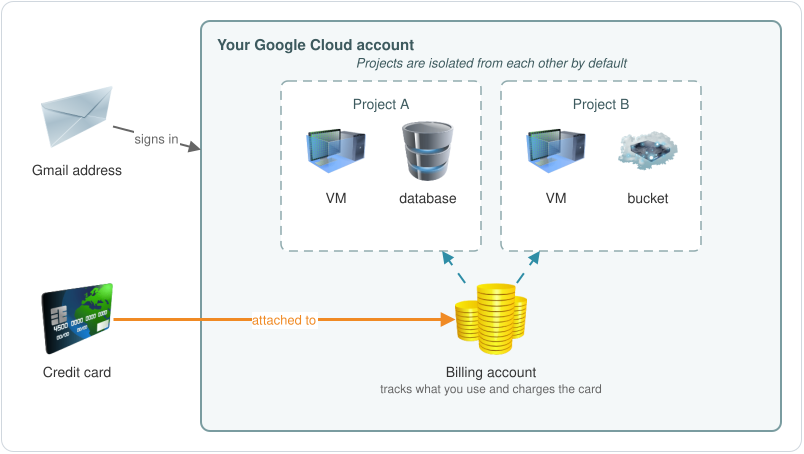
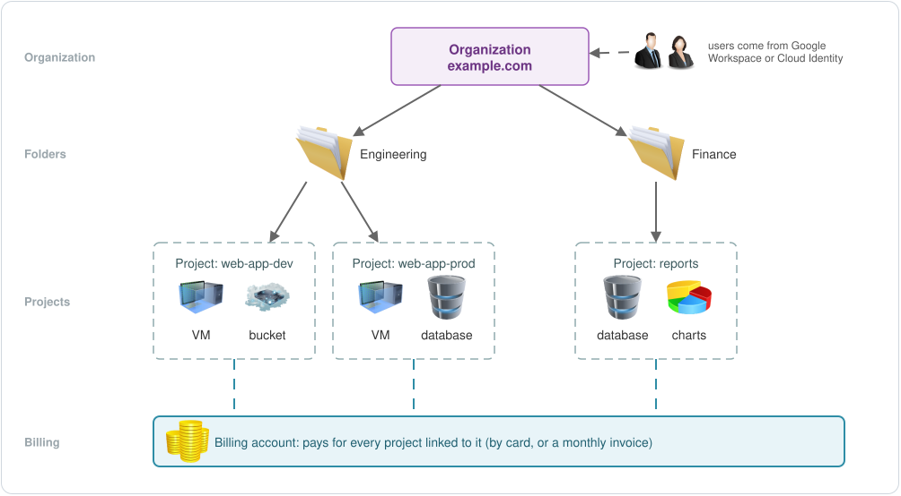
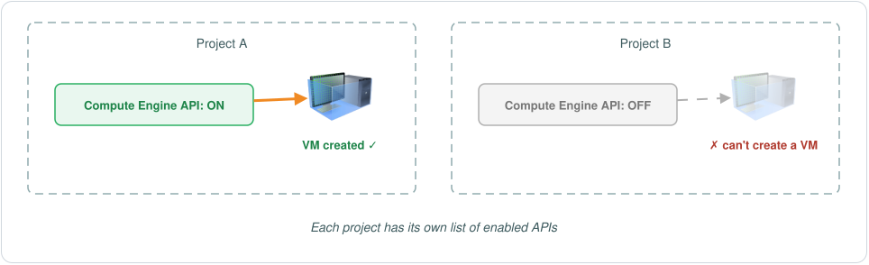
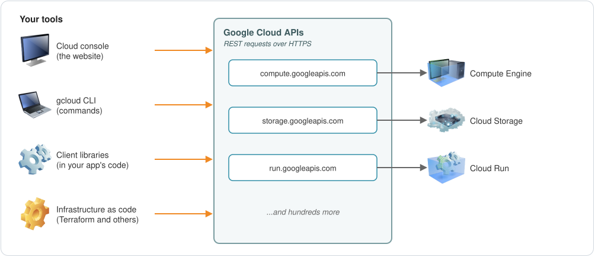
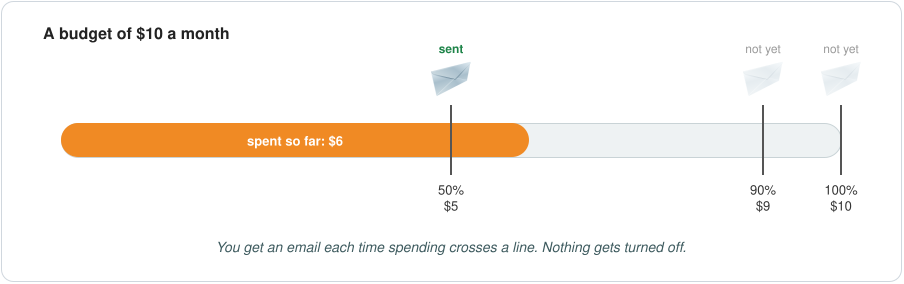

# EP-02: Accounts, Projects and APIs

**English** | [عربي](README.ar.md)

EP-01 was about the big picture: Google's network, regions and zones, and the kinds of services GCP offers. This part is lighter and more hands-on. We'll see how accounts, billing and projects fit together, and how you talk to Google Cloud through its APIs. Then we'll do it for real: create an account, set a budget, create a project and turn on an API, first in the console and then from the command line.

## Who uses Google Cloud?

Two kinds of users sign up:

- **One person**: someone learning, someone trying out an idea (a proof of concept), or a freelancer building projects for clients.
- **An organization**: a company that runs its apps on Google Cloud.

Both work the same way underneath, but companies get a few extra layers on top. We'll start with one person.

## Your own account

To use Google Cloud on your own, you need a **Google Cloud account**, and to create one you need two things: a **Gmail address** and a **credit card**.

### Billing account

When you set up the account, your card gets attached to a **billing account**. That's how Google keeps track of what you use and charges you for it. You can have more than one billing account if you need to keep payments separate.

### Projects

The first thing you create is a **project**. A project is a container for your resources: every VM, disk, bucket or database you create lives inside a project. You can have one project or many.

Every project has to be linked to a billing account. Without one, you can't use the services that cost money in it, because Google needs to know who's going to pay.

Why would one person need several projects? Maybe you're trying out different ideas, or you're a freelancer with a few clients and want each client's work kept apart. That works well because projects are isolated from each other by default: resources in one project can't reach resources in another unless you set that up on purpose.



### Name, ID and number

Every project has three identifiers:

| | Example | Can you change it? |
|---|---|---|
| Project name | `My Blog` | Yes, any time |
| Project ID | `my-blog-482913` | No, it's permanent |
| Project number | `512345678901` | No, Google assigns it |

The name is just a label for humans. The **project ID** is the one that matters: you'll type it in commands and use it in code all the time. It must be 6 to 30 characters long, using lowercase letters, numbers and hyphens, and it has to start with a letter. It also has to be unique across all of Google Cloud, not just your account. Once a project is created, its ID can't change, and even after you delete the project, nobody can use that ID again. So it's worth a few seconds of thought.

## Companies: organizations and folders

A company works the same way, with a few differences.

Instead of personal Gmail addresses, a company usually uses **Google Workspace**. It's Google's set of tools for businesses: Gmail on the company's own domain, Drive, Meet and more, with one place to manage all the users and their data. The company connects its domain, like `example.com`, to Workspace.

If a company doesn't want all of that, it can use **Cloud Identity** instead. It gives you the user and group management that Google Cloud needs, without Gmail, Drive and the other apps.

The big difference is the **organization**. It sits at the top and represents the whole company, by its domain. Under it, the company creates **folders** and arranges them however it likes: by department, by team, or by environment like dev and prod. Projects go inside the folders, and resources go inside the projects.

Billing works the same way: projects are linked to billing accounts. A company can pay by card too, and companies that qualify can get a monthly invoice instead.



This tree is called the **resource hierarchy**, and it becomes important later. Permissions you give on a folder, for example, apply to every project inside it. We'll get there in the IAM part.

## How you talk to Google Cloud: APIs

Every service in Google Cloud has an **API**: a set of endpoints that programs call to use that service. If APIs are new to you, it's worth reading up on them now, because you'll run into them everywhere.

Compute Engine, the service for VMs, has the Compute Engine API at `compute.googleapis.com`. Cloud Storage has its own at `storage.googleapis.com`. There are hundreds more.

Most Google Cloud APIs are REST APIs: you send an HTTPS request and get JSON back. So any app or tool that can send HTTP requests can use Google Cloud. In practice, you'd have to deal with signing in, tokens and request details yourself, which is a lot of work. That's why Google gives you tools that handle it for you.

### Turn on the APIs you need

Before you can use a service in a project, its API has to be **enabled** in that project. If a project needs VMs, you enable the Compute Engine API in it.

This is per project. Enabling an API in one project doesn't enable it anywhere else, and a new project has only a few APIs turned on by default, so you enable what you need each time.



## Four ways to work with Google Cloud

1. **The Google Cloud console**: the website. It's the easiest way to look around and create resources by clicking.
2. **The gcloud CLI** (Google Cloud CLI): a command-line tool. Anything you can do in the console, you can do with gcloud. And because it's just commands, you can put them in a Bash or PowerShell script and repeat a whole setup in seconds.
3. **Cloud Client Libraries**: libraries for languages like Python, Java, Go and Node.js. Developers use them to call Google Cloud services from inside their app's code.
4. **Infrastructure as code (IaC)**: you describe your infrastructure in files, and a tool creates it for you. Terraform is the best known, and Crossplane and Ansible work with Google Cloud too. DevOps and platform engineers lean on these once the infrastructure gets big.

All four end up calling the same APIs:



Which ones should you learn? All four are useful, but what matters is knowing when each one fits. Don't pick a tool just because everyone else uses it. First understand what it does for you.

Start with the console and gcloud. They're the base for everything else. Get used to gcloud early instead of relying on the console alone: typing the commands shows you what a resource is actually made of. Infrastructure as code makes more sense later, when you're building bigger things and want to create them faster.

## Hands-on

### 1. Create your account

1. Go to [cloud.google.com](https://cloud.google.com) and start the free trial.
2. Sign in with your Gmail address.
3. Choose your country, accept the terms and continue.
4. Pick **Individual** as the account type, and fill in your name and address.
5. Add your credit card and start the trial.

That's it, you're in. New accounts get a free trial: **$300 in credit to use within 90 days**. The card is there to check that you're a real person. Google may put a small temporary hold on it, but it won't charge you during the trial, and when the trial ends, the trial billing account simply closes. You're only ever charged if you upgrade to a paid account yourself.

### 2. Set a budget first

Before creating anything, set a budget. It's what warns you if you leave something running and forget about it.

1. In the console, open **Billing** and select your billing account. The cost is zero for now, since you haven't created anything.
2. Go to **Budgets & alerts** and click **Create budget**.
3. Give it a name. Leave the time range as monthly and the scope as all projects and all services, so it covers everything.
4. Set an amount, for example $10 a month (it uses your billing account's currency).
5. Set the alert thresholds. The defaults are 50%, 90% and 100% of the budget, and you can add more, like 80%. Each one can be based on **actual** spend (what you've spent so far) or **forecasted** spend (what Google expects you to have spent by the end of the month).
6. Keep email alerts to billing admins and users turned on, and click **Finish**.



One thing to be clear about: this budget only sends emails. It doesn't stop or slow down anything. If an alert comes in, it's up to you to go and turn things off.

### 3. Create a project

1. Click the project picker at the top of the console. As one person, you'll see **No organization**, which is expected.
2. Click **New project**.
3. Type a project name. Under it, Google suggests a project ID. You can edit the ID now, but not after the project is created.
4. Click **Create**, then pick the new project in the project picker.

You're now inside your first project.

### 4. Enable an API

Open **Compute Engine** in your new project. Its API isn't enabled yet, so the console asks you to enable it first. You can click **Enable** right there, or do it from the API library:

1. Go to **APIs & Services** > **Library**. This is the full list of Google Cloud APIs.
2. Search for "Compute Engine API", open it and click **Enable**.

After a minute or so, the Compute Engine page opens and you can start creating VMs.

### 5. Do the same with gcloud

Install the gcloud CLI using the [install guide](https://docs.cloud.google.com/sdk/docs/install). There are versions for Windows, macOS and Linux. Then sign in and check that it works:

```bash
# sign in and choose a default project
gcloud init

# which account and project is gcloud using?
gcloud config list
```

Look at your projects:

```bash
gcloud projects list
gcloud projects describe PROJECT_ID
```

`describe` shows the project's name, ID and number, and when it was created.

Now create a second project and turn on a couple of APIs in it:

```bash
# gcloud suggests an ID and asks you to confirm it
gcloud projects create --name="My Second Project"

# use the new project for the commands that follow
gcloud config set project NEW_PROJECT_ID

# this can take a minute or two
gcloud services enable compute.googleapis.com
gcloud services enable run.googleapis.com

# what's enabled now?
gcloud services list --enabled
```

If `services enable` fails with an error about billing, the new project isn't linked to a billing account yet. Link it and try again:

```bash
gcloud billing accounts list
gcloud billing projects link NEW_PROJECT_ID --billing-account=BILLING_ACCOUNT_ID
```

Back in the console, the new project shows up in the project picker, and your budget covers it too, because it watches all projects. Open Compute Engine in it and there's nothing to enable: gcloud already did it.

### No install? Use Cloud Shell

Cloud Shell is a small Linux machine that Google runs for you, right in the browser, with gcloud already installed. Open it from the terminal icon at the top of the console. The first time you run a gcloud command there, it asks you to authorize it. After that, it works like your own terminal:

```bash
gcloud version
gcloud projects list
```

## Recap

- To use Google Cloud on your own, you need a Gmail address and a credit card. The card is attached to a billing account, which tracks what you use and pays for it.
- A project is a container for resources. Every project must be linked to a billing account, and projects are isolated from each other by default.
- A project has a name (you can change it), an ID (unique and permanent) and a number (assigned by Google).
- Companies get their users from Google Workspace or Cloud Identity, and get an organization at the top, folders under it and projects under the folders.
- Every service has an API, and you enable each API in every project that uses it.
- You can work with Google Cloud through the console, the gcloud CLI, client libraries or infrastructure as code. They all call the same APIs.
- Set a budget before you build anything. It warns you, but it doesn't stop the spending.

## Test yourself

1. What two things do you need to create a Google Cloud account on your own?
2. What is a billing account for?
3. What happens if a project isn't linked to a billing account?
4. Why might one person want several projects?
5. Which can you change later: the project name, the project ID or the project number?
6. What does a company get that one person doesn't?
7. You enabled the Compute Engine API in project A. Can you create a VM in project B right away?
8. Your budget is $10 and you've just spent $10. What does Google do?

<details>
<summary>Answers</summary>

1. A Gmail address and a credit card.
2. It tracks what you use and pays for it. Projects are linked to a billing account.
3. You can't use the services that cost money in it.
4. To keep things apart, like different experiments or different clients. Projects are isolated from each other by default.
5. Only the name. The ID is permanent, and the number is assigned by Google.
6. An organization at the top, tied to the company's domain, and folders to arrange projects. Its users come from Google Workspace or Cloud Identity, and it can pay with a monthly invoice if it qualifies.
7. No. APIs are enabled per project, so you have to enable it in project B as well.
8. It sends an alert email. Nothing is stopped; turning things off is up to you.

</details>

## Next

EP-03: IAM, or who is allowed to do what in Google Cloud.

---

<sub>Useful links: [Free trial](https://docs.cloud.google.com/free/docs/free-cloud-features) · [Creating and managing projects](https://docs.cloud.google.com/resource-manager/docs/creating-managing-projects) · [Resource hierarchy](https://docs.cloud.google.com/resource-manager/docs/cloud-platform-resource-hierarchy) · [Budgets and alerts](https://docs.cloud.google.com/billing/docs/how-to/budgets) · [Install the gcloud CLI](https://docs.cloud.google.com/sdk/docs/install) · [Cloud Shell](https://docs.cloud.google.com/shell/docs)</sub>
