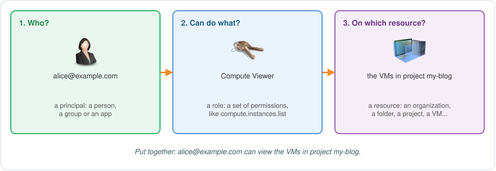

<div dir="rtl" lang="ar">

# الـ IAM، إدارة الهويات والصلاحيات: الجزء الأول (EP-03)

**عربي** | [English](README.md)

في EP-02 عملنا projects وشغّلنا فيها APIs. بس فيه سؤال فضل مفتوح: مين مسموح له يعمل حاجات في الـ projects دي؟ وده بالظبط شغل الـ **Identity and Access Management**، أو الـ **IAM**.

هتسمع عن الـ IAM كتير، وغالبًا لما يبقى فيه حاجة بايظة. ممكن permission واحدة ناقصة توقف شغلك: VM مش قادرة تقرا ملفات من bucket، أو جزء من السيستم مش قادر يكلم جزء تاني بالطريقة اللي انت متوقعها. والـ IAM بيظهر كمان في حاجات كتير من تسريبات الداتا (data breaches). نادرًا ما بيكون هو السبب الأساسي، بس role متدية لناس غلط، أو داتا متسابة مفتوحة لأي حد، بتسهّل شغل اللي بيهاجم جدًا.

الجزء ده بيغطي الأساسيات: السؤال اللي الـ IAM بيجاوب عليه، ومين ممكن ياخد access، والـ roles يعني إيه، والـ access بينزل إزاي في الـ resource hierarchy. والجزء التاني بيكمّل بالـ service accounts.

## ليه محتاج IAM؟

لما الـ Google Cloud account بيبقى لسه جديد، بيبقى فيه شخص واحد بس عنده full access على كل حاجة: انت، لو ده الـ account بتاعك، أو الـ admins بتوع الـ organization، لو الـ account بتاع شركة.

ده تمام وانت بتتعلم لوحدك. بس في شركة، كل project غالبًا بيبقى تبع team معين، وساعات كذا project مع بعض بيكوّنوا product واحد. الـ developers اللي في الـ team محتاجين يعملوا VMs في الـ projects بتاعتهم. والـ analyst محتاج يقرا شوية reports بس. والتطبيق اللي شغال على VM محتاج يقرا ملفات من bucket. لو اديت كل دول full access، غلطة واحدة ممكن تبوّظ كل حاجة. ولو مادتهمش حاجة، مفيش شغل هيخلص.

والـ IAM بيخليك تدي كل واحد فيهم اللي محتاجه بالظبط. وكل rule في الـ IAM بتجاوب على سؤال واحد:

> **مين** يقدر يعمل **إيه**، على **أنهي resource**؟



خلينا ناخد التلات أجزاء واحد واحد.

## مين: الـ principals

في الـ IAM، أي حاجة ممكن تاخد access اسمها **principal**. ودي أهم الأنواع:

<table dir="rtl">
<thead>
<tr><th align="right" style="text-align:right">الـ Principal</th><th align="right" style="text-align:right">هو إيه</th><th align="right" style="text-align:right">بتكتبه إزاي</th></tr>
</thead>
<tbody>
<tr><td>الـ Google Account</td><td>شخص واحد، زي developer أو admin. الإيميل ممكن يبقى على الـ domain بتاع الشركة، أو إيميل Gmail.</td><td><code>user:alice@example.com</code></td></tr>
<tr><td>الـ Google group</td><td>مجموعة Google Accounts ليها إيميل خاص بيها. لما تدي الـ group access، كل اللي فيها بياخدوه.</td><td><code>group:devs@example.com</code></td></tr>
<tr><td>الـ domain بتاع Google Workspace أو Cloud Identity</td><td>كل الـ accounts اللي على الـ domain بتاع الشركة.</td><td><code>domain:example.com</code></td></tr>
<tr><td>الـ Service account</td><td>ده account لتطبيق، مش لشخص. التطبيق بتاعك بيستخدمه عشان يكلم خدمات Google Cloud التانية.</td><td><code>serviceAccount:my-app@my-project.iam.gserviceaccount.com</code></td></tr>
<tr><td>كل الـ authenticated users</td><td>أي حد على الإنترنت عامل sign in بـ Google Account، ومعاهم كل الـ service accounts.</td><td><code>allAuthenticatedUsers</code></td></tr>
<tr><td>كل الـ users</td><td>أي حد على الإنترنت، سواء عامل sign in أو لأ.</td><td><code>allUsers</code></td></tr>
</tbody>
</table>

العمود الأخير هو الطريقة اللي بتكتب بيها الـ principal لما تديله access. وهتشوف الشكل ده في الـ commands وفي الـ policies.

كام حاجة يستاهل تعرفها من بدري:

- **فضّل الـ groups على الـ users الفرديين.** ادي الـ access لـ group زي `devs@example.com` بدل ما تديه لكل developer لوحده. لما حد ينضم للـ team بتضيفه للـ group، ولما يمشي بتشيله منها. والـ rules نفسها مش بتتغير.
- **الـ `allAuthenticatedUsers` مش معناها "الـ users بتوع شركتي".** معناها أي حد عنده Google Account، يعني تقريبًا كل الناس. واللخبطة بين الاتنين دول طريقة مشهورة جدًا لتسريب الداتا.
- **الـ `allUsers` بتخلي الحاجة public.** استخدمها بس مع الحاجات اللي المفروض تبقى public، زي الصور اللي على website عام.
- **الـ Service accounts** ليها جزء لوحدها المرة الجاية.

وفيه كمان كام نوع principals تاني، أغلبهم لهويات (identities) جاية من بره Google. هنتكلم عليهم لما نحتاجهم.

## إيه: الـ permissions والـ roles

الـ **permission** بتسمح بـ action واحد على نوع واحد من الـ resources. واسمها متقسم تلات أجزاء، `service.resource.verb`:

- الـ `compute.instances.list`: تعرض الـ VMs
- الـ `compute.instances.start`: تشغّل VM
- الـ `compute.instances.stop`: توقف VM
- الـ `compute.disks.create`: تعمل disk
- الـ `storage.buckets.list`: تعرض الـ buckets
- الـ `storage.objects.get`: تقرا ملف في bucket
- الـ `storage.objects.delete`: تمسح ملف من bucket

الخدمة الواحدة ممكن يبقى فيها أكتر من 100 permission، و Google Cloud كله فيه آلاف. ولو هتختارهم واحدة واحدة لكل شخص هتتعب جدًا، وعشان كده مش بتعمل كده. في Google Cloud، مينفعش تدي حد permission بشكل مباشر. انت بتديله **role**، والـ role عبارة عن مجموعة permissions ليها اسم، وهو بياخد كل الـ permissions اللي فيها.

### تلات أنواع من الـ roles

الـ **Predefined roles** دي Google هي اللي بتعملها وبتحافظ عليها. كل واحدة فيهم مناسبة لشغلانة معروفة في خدمة واحدة، و Google بتحدّثها كل ما الخدمات بتتغير. ودي أمثلة:

<table dir="rtl">
<thead>
<tr><th align="right" style="text-align:right">الـ Role</th><th align="right" style="text-align:right">الـ ID</th><th align="right" style="text-align:right">بتسمح بإيه</th></tr>
</thead>
<tbody>
<tr><td>الـ Compute Viewer</td><td><code>roles/compute.viewer</code></td><td>تشوف الـ resources بتاعة Compute Engine من غير ما تغير فيها (read-only)</td></tr>
<tr><td>الـ Compute Instance Admin</td><td><code>roles/compute.instanceAdmin.v1</code></td><td>تحكم كامل في الـ VMs والـ disks بتاعتها</td></tr>
<tr><td>الـ Storage Object Viewer</td><td><code>roles/storage.objectViewer</code></td><td>تقرا الملفات اللي في الـ buckets</td></tr>
<tr><td>الـ Storage Admin</td><td><code>roles/storage.admin</code></td><td>تحكم كامل في الـ buckets والملفات اللي فيها</td></tr>
</tbody>
</table>

الـ **Basic roles** هي أقدم تلات roles: الـ **Owner** والـ **Editor** والـ **Viewer**. كانوا موجودين من قبل ما الـ IAM يبقى موجود، وبيغطوا تقريبًا كل خدمة في الـ project:

- الـ **Viewer** يقدر يشوف تقريبًا كل حاجة، من غير ما يغير أي حاجة.
- الـ **Editor** يقدر يعمل كل اللي الـ Viewer بيعمله، وكمان يعمل ويغير ويمسح أغلب الـ resources.
- الـ **Owner** يقدر يعمل كل اللي الـ Editor بيعمله، وكمان يدير مين عنده access ويظبط الـ billing.

ده أكتر بكتير من اللي أغلب الناس محتاجاه. ونصيحة Google إنك ماتستخدمش الـ basic roles في الـ production إلا لو مفيش أي اختيار تاني.

الـ **Custom roles** بتستخدمها لما مفيش predefined role مناسبة: يمكن أقرب واحدة بتدي أكتر من اللازم، أو شغل الـ team بتاعك مش راكب على أي واحدة فيهم. بتختار الـ permissions بالظبط، وتدي الـ role اسم، وتستخدمها زي أي role تانية. وتقدر تعمل custom role في organization أو في project، بس مش في folder. ولأنك انت اللي عاملها، انت اللي بتحافظ عليها، و Google مش هتحدّثها لك.


وكل ده بيرجع لفكرة واحدة اسمها الـ **principle of least privilege**: ادي كل principal الـ permissions اللي محتاجها عشان يعمل شغله بس، ومفيش حاجة زيادة. والـ predefined roles غالبًا هي المكان اللي تبدأ منه.

## نجمّع الحاجات دي: الـ role bindings والـ allow policies

دلوقتي بقى عندنا "مين" (الـ principals) و"إيه" (الـ roles). والخطوة اللي بتربطهم ببعض اسمها **role binding**، يعني role واحدة ومعاها لستة الـ principals اللي هياخدوها. مثلًا: "الـ Compute Viewer لـ Alice و Bob".

والـ role bindings بتاعة أي resource بتتجمع مع بعض في **allow policy**. ودي document صغير، وهي من جوه عبارة عن JSON:

<div dir="ltr">

```json
{
  "bindings": [
    {
      "role": "roles/compute.viewer",
      "members": [
        "user:alice@example.com",
        "user:bob@example.com"
      ]
    },
    {
      "role": "roles/storage.objectViewer",
      "members": [
        "group:analysts@example.com"
      ]
    }
  ]
}
```

</div>

الـ policy الحقيقية فيها كمان field اتنين، `etag` و `version`، و Google بتستخدمهم عشان تتابع التغييرات. تقدر تتجاهلهم دلوقتي.

والجزء الأخير بيجاوب على "على أنهي resource": الـ allow policy بتتربط (**attached**) بـ resource، زي project. والـ resource الواحد مايبقاش ليه غير allow policy واحدة، والـ policy دي فيها كل الـ role bindings بتاعته.


## أنهي resource: تحط الـ policy فين؟

تقدر تربط allow policy في أي مستوى تقريبًا: الـ organization، أو folder، أو project، وكمان بعض الـ resources لوحدها، زي VM واحدة أو bucket واحد. طب تختار أنهي مستوى؟ عشان تجاوب على ده، لازم تعرف الـ policies بتنزل إزاي في الـ resource hierarchy.

نفتكر بسرعة من EP-02: الـ organization فوق خالص. وتحتها الـ folders، واللي ممكن يبقى جواها folders تانية (sub-folders)، وبعدين الـ projects، وبعدين الـ resources اللي جوه الـ projects. وكل resource ليه parent واحد بس.

### القاعدة الأولى: الـ resource بيورث الـ policies بتاعة اللي فوقه

الـ resource بياخد الـ allow policies بتاعة الـ parent بتاعه، وبتاعة الـ parent بتاع الـ parent، وهكذا لحد الـ organization.

افترض إنك ربطت policy بالـ folder بتاع **Engineering**، بتدي الـ engineering group الـ role بتاعة Compute Viewer. كل sub-folder و project و VM تحت Engineering هيورثها، فالـ group هيقدر يشوف الـ VMs اللي في كل الـ projects دي. أما Media و Analytics فمش تحت Engineering، فمش هيتأثروا.

### القاعدة التانية: الـ effective policy هي كل دول مع بعض

الـ access اللي بيتطبق فعلًا على الـ resource اسمه الـ **effective policy** بتاعته. ودي الـ policy المربوطة بالـ resource نفسه، زائد كل policy بيورثها من فوق.

نرجع للمثال. فيه واحدة اسمها Sara محتاجة تدير VM واحدة بس، `vm-2`، ومش محتاجة حاجة تانية. فبتربط policy بالـ `vm-2` لوحدها، بتدي Sara الـ role بتاعة Compute Instance Admin. دلوقتي الـ effective policy بتاعة `vm-2` فيها الاتنين: الـ Compute Viewer للـ engineering group، واللي ورثتها من الـ folder، والـ Compute Instance Admin بتاعة Sara، واللي جاية من الـ policy بتاعتها هي. وباقي الـ VMs مش هتاخد الـ role بتاعة Sara.


فيه حاجتين بييجوا من القواعد دي:

- **الـ allow policies بتزوّد access بس.** لو حد خد role على folder، مفيش allow policy تحت تقدر تشيلها منه على project معين. (وفيه نوع تاني من الـ policies في Google Cloud لمنع الـ access، اسمه deny policy.)
- **كل ما تربط الـ policy في مستوى أعلى، كل ما توصل لحاجات أكتر.** الـ role اللي بتتدي على الـ organization بتنطبق على كل project في الشركة. فادي الـ access في أقل مستوى لسه بيغطي اللي محتاجه.

### مثال محلول

عندنا project واحد اسمه `project-1`، وفيه اتنين VMs هما `vm-1` و `vm-2`:

- الـ policy بتاعة `project-1` بتدي Compute Viewer لـ Alice و Bob.
- الـ policy بتاعة `vm-2` بتدي Compute Admin لـ Alice.

ودي الـ effective policy بتاعة كل VM:

<table dir="rtl">
<thead>
<tr><th align="right" style="text-align:right"></th><th align="right" style="text-align:right">Alice</th><th align="right" style="text-align:right">Bob</th></tr>
</thead>
<tbody>
<tr><td><code>vm-1</code></td><td>الـ Compute Viewer (جاية من الـ project)</td><td>الـ Compute Viewer (جاية من الـ project)</td></tr>
<tr><td><code>vm-2</code></td><td>الـ Compute Viewer (جاية من الـ project) + الـ Compute Admin (بتاعة الـ VM نفسها)</td><td>الـ Compute Viewer (جاية من الـ project)</td></tr>
</tbody>
</table>

يعني Bob يقدر يشوف الـ VMs الاتنين، بس مايقدرش يغير في أي واحدة فيهم. و Alice تقدر تشوف الاتنين، وكمان تقدر تدير `vm-2` بالكامل، بس مش `vm-1`.


## إزاي تدي role بالـ gcloud

إنك تدي role بياخد command واحد بس. ونفس الـ command في كل المستويات، واللي بيتغير هو الـ resource بس.

على VM واحدة:

<div dir="ltr">

```bash
gcloud compute instances add-iam-policy-binding INSTANCE_NAME --zone=ZONE \
    --member=PRINCIPAL --role=ROLE
```

</div>

على project:

<div dir="ltr">

```bash
gcloud projects add-iam-policy-binding PROJECT_ID \
    --member=PRINCIPAL --role=ROLE
```

</div>

على folder:

<div dir="ltr">

```bash
gcloud resource-manager folders add-iam-policy-binding FOLDER_ID \
    --member=PRINCIPAL --role=ROLE
```

</div>

على الـ organization:

<div dir="ltr">

```bash
gcloud organizations add-iam-policy-binding ORGANIZATION_ID \
    --member=PRINCIPAL --role=ROLE
```

</div>

الـ `PRINCIPAL` بيتكتب بنفس الشكل اللي في جدول الـ principals، زي `user:alice@example.com`، والـ `ROLE` هو الـ ID بتاع الـ role، زي `roles/compute.viewer`. والـ command بيقرا الـ allow policy بتاعة الـ resource، ويزوّد عليها الـ binding، ويحفظها تاني. ولو الـ policy فيها binding للـ role دي أصلًا، الـ principal بيتضاف للـ members بتوعها.

## جرّب بنفسك

الـ account الشخصي مفيهوش organization ولا folders، بس الـ projects بتشتغل بنفس الطريقة بالظبط. والـ EP-05 عبارة عن lab عملي كامل للـ IAM، ودي مجرد نظرة أولى.

شوف مين عنده access على الـ project بتاعك:

<div dir="ltr">

```bash
gcloud projects get-iam-policy PROJECT_ID
```

</div>

هتلاقي نفسك موجود بـ `roles/owner`. ودي الطريقة اللي بياخد بيها اللي عمل الـ project الـ full access عليه.

بص جوه role عشان تشوف فيها أنهي permissions:

<div dir="ltr">

```bash
gcloud iam roles describe roles/compute.viewer
```

</div>

دلوقتي ادي Google Account تاني (بتاع صاحبك، أو إيميل Gmail تاني بتاعك) access يشوف بيه الـ VMs اللي في الـ project بتاعك من غير ما يغير فيها:

<div dir="ltr">

```bash
gcloud projects add-iam-policy-binding PROJECT_ID \
    --member="user:friend@gmail.com" --role="roles/compute.viewer"
```

</div>

وتقدر تعمل نفس الحاجة من الـ console: افتح **IAM & Admin** وبعدين **IAM**، ودوس **Grant access**، واكتب الإيميل، واختار الـ role، واعمل save. ولو شغّلت `get-iam-policy` تاني، هتلاقي الـ binding الجديد.

ولما تخلص، شيل الـ access ده:

<div dir="ltr">

```bash
gcloud projects remove-iam-policy-binding PROJECT_ID \
    --member="user:friend@gmail.com" --role="roles/compute.viewer"
```

</div>

## الخلاصة

- الـ IAM بيجاوب على سؤال واحد: مين يقدر يعمل إيه، على أنهي resource.
- الـ principal هو أي حاجة ممكن تاخد access، زي Google Account، أو group، أو domain كامل، أو service account، أو أي حد على الإنترنت (`allAuthenticatedUsers` و `allUsers`).
- الـ permission هي action واحد، واسمها بيبقى `service.resource.verb`. ومفيش حد بياخد permissions بشكل مباشر. انت بتدي roles، والـ role عبارة عن مجموعة permissions.
- فيه تلات أنواع roles: الـ predefined (معمولة من Google، وهي الاختيار المعتاد)، والـ basic (الـ Owner والـ Editor والـ Viewer، وأوسع من اللازم للـ production)، والـ custom (انت اللي بتختار الـ permissions بتاعتها).
- الـ role binding هو role ومعاها الـ principals اللي بياخدوها. والـ allow policy هي مجموعة الـ role bindings المربوطة بـ resource واحد، والـ resource مايبقاش ليه غير واحدة بس.
- الـ resource بيورث الـ policies بتاعة كل اللي فوقه. والـ effective policy بتاعته هي الـ policy بتاعته هو، زائد كل اللي ورثه، والـ allow policies بتزوّد access بس.
- ادي كل principal اللي محتاجه بس، وفي أقل مستوى ينفع.

## اختبر نفسك

1. إيه التلات أجزاء بتوع السؤال اللي الـ IAM بيجاوب عليه؟
2. ليه أحسن تدي الـ access لـ group، بدل ما تديه لكل شخص في الـ team لوحده؟
3. زميلك عاوز يشارك ملف مع الناس اللي في شركتكم بس، فادى `allAuthenticatedUsers` access عليه. إيه الغلط في كده؟
4. اسم الـ permission ده `compute.instances.stop` بيقولك إيه؟
5. ينفع تدي حد permission واحدة بشكل مباشر؟
6. ليه Google بتنصح إنك ماتستخدمش الـ basic roles في الـ production؟
7. محتاج role فيها خمس permissions معينين، ومفيش predefined role مناسبة. هتعمل إيه، وتقدر تعملها فين؟
8. إيه الفرق بين الـ role binding والـ allow policy؟
9. عند Bob الـ Compute Viewer على الـ folder بتاع Engineering. ينفع تشيلها منه على project واحد تحت Engineering، عن طريق إنك تغير الـ allow policy بتاعة الـ project ده؟
10. في المثال المحلول، تقدر Alice توقف `vm-1`؟

<details>
<summary>الإجابات</summary>

1. مين، يقدر يعمل إيه، على أنهي resource.
2. بتدير الناس عن طريق إنك تضيفهم للـ group أو تشيلهم منها، والـ policies بتفضل زي ما هي. وكمان بيبقى صعب تنسى access حد بعد ما يمشي.
3. الـ `allAuthenticatedUsers` معناها أي حد عامل sign in بأي Google Account، مش الناس اللي في شركتك بس. لو عاوز تشارك مع الشركة كلها، استخدم الـ domain، يعني `domain:example.com`، أو group.
4. أول جزء بيقولك إنها في Compute Engine، وده `compute`. والتاني إنها عن الـ VMs، وده `instances`. والتالت إن الـ action هو إنك توقف VM، وده `stop`.
5. لأ. انت بتدي role، والـ principal بياخد كل الـ permissions اللي فيها.
6. لأنها بتدي access أكتر بكتير من اللي أغلب الناس محتاجينه، على تقريبًا كل خدمة في الـ project. وده عكس الـ least privilege.
7. اعمل custom role فيها الخمس permissions دول. وتقدر تعملها في organization أو في project، بس مش في folder.
8. الـ role binding هو role واحدة ومعاها الـ principals اللي بياخدوها. والـ allow policy هي كل الـ role bindings المربوطة بـ resource واحد.
9. لأ. الـ project بيورث الـ policy بتاعة الـ folder، والـ allow policies بتزوّد access بس. لازم تغير الـ policy بتاعة الـ folder نفسه (أو تستخدم deny policy).
10. لأ. على الـ `vm-1` هي عندها Compute Viewer بس، جاية من الـ project. والـ Compute Admin بتاعتها على الـ `vm-2` بس.

</details>

## الجاي

الجزء الجاي (EP-04) عن الـ service accounts والـ keys والـ impersonation، وده الجزء التاني من الـ IAM.

---

<sub>روابط مفيدة: [نظرة عامة على الـ IAM](https://docs.cloud.google.com/iam/docs/overview) · [الـ Principals](https://docs.cloud.google.com/iam/docs/principals-overview) · [الـ Roles والـ permissions](https://docs.cloud.google.com/iam/docs/roles-overview) · [الـ Allow policies](https://docs.cloud.google.com/iam/docs/allow-policies) · [وراثة الـ policies](https://docs.cloud.google.com/iam/docs/resource-hierarchy-access-control) · [إزاي تدي access وتشيله](https://docs.cloud.google.com/iam/docs/granting-changing-revoking-access) · [كل الـ roles والـ permissions](https://docs.cloud.google.com/iam/docs/roles-permissions) · [الـ Deny policies](https://docs.cloud.google.com/iam/docs/deny-overview)</sub>

</div>
