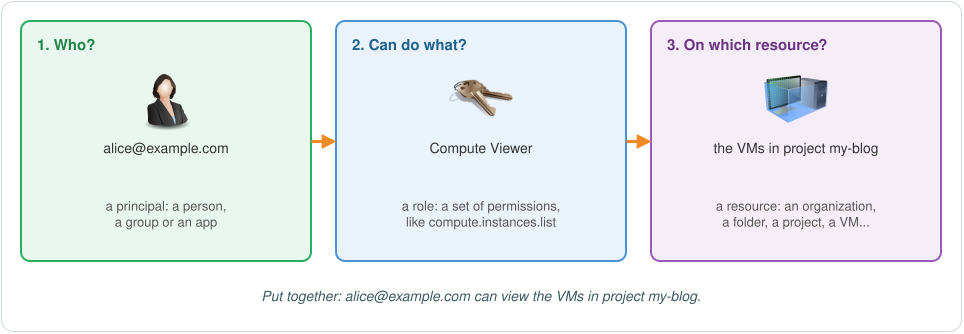
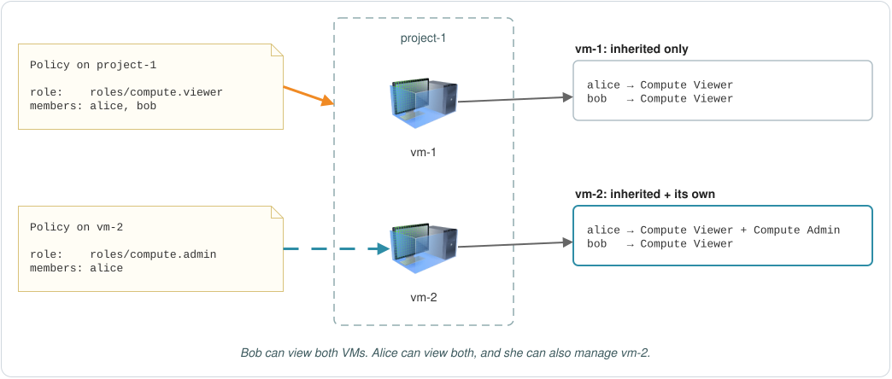

# EP-03: Identity and Access Management (IAM), Part 1

**English** | [عربي](README.ar.md)

In EP-02 we created projects and turned on APIs in them. One question was left open: who is allowed to do things in those projects? That's the job of **Identity and Access Management**, or **IAM**.

You'll hear about IAM a lot, and usually when something is wrong. One missing permission can stop your work: a VM can't read files from a bucket, or one part of your system can't talk to another the way you expected. IAM also comes up in a lot of data breaches. It's rarely the main cause, but a role given to the wrong people, or data left open to everyone, makes an attacker's job much easier.

This part covers the basics: the question IAM answers, who can get access, what roles are, and how access flows down the resource hierarchy. Part 2 continues with service accounts.

## Why you need IAM

When a Google Cloud account is new, only one person has full access to everything: you, if it's your own account, or the organization's admins, if it belongs to a company.

That's fine when you're learning on your own. In a company, though, each project usually belongs to a team, and sometimes a few projects together make up one product. The developers on a team need to create VMs in their own projects. An analyst only needs to read some reports. An app running on a VM needs to read files from a bucket. Give all of them full access and one mistake can break everything. Give them nothing and no work gets done.

IAM lets you give each of them exactly what they need. Every rule in IAM answers one question:

> **Who** can do **what** on **which resource**?



Let's take the three parts one at a time.

## Who: principals

In IAM, anything that can be given access is called a **principal**. These are the main kinds:

| Principal | What it is | How you write it |
|---|---|---|
| Google Account | One person, like a developer or an admin. The email can be on the company's domain or a Gmail address. | `user:alice@example.com` |
| Google group | A group of Google Accounts with its own email address. Give the group access, and everyone in it gets it. | `group:devs@example.com` |
| Google Workspace or Cloud Identity domain | Every account in the company's domain. | `domain:example.com` |
| Service account | An account for an app, not a person. Your app uses it to call other Google Cloud services. | `serviceAccount:my-app@my-project.iam.gserviceaccount.com` |
| All authenticated users | Anyone on the internet who's signed in with a Google Account, plus all service accounts. | `allAuthenticatedUsers` |
| All users | Anyone on the internet, signed in or not. | `allUsers` |

The last column is how you write the principal when you give it access. You'll see this format in commands and in policies.

A few things worth knowing early:

- **Prefer groups over single users.** Give access to a group like `devs@example.com` instead of to each developer. When someone joins the team, you add them to the group, and when they leave, you remove them. The access rules themselves don't change.
- **`allAuthenticatedUsers` doesn't mean "my company's users".** It means anyone with a Google Account, which is almost everyone. Mixing the two up is a classic way to leak data.
- **`allUsers` makes something public.** Use it only for things that are meant to be public, like the images on a public website.
- **Service accounts** get a part of their own next time.

There are a few more kinds of principals, mostly for identities that come from outside Google. We'll get to them when we need them.

## What: permissions and roles

A **permission** allows one action on one type of resource. Its name has three parts, `service.resource.verb`:

- `compute.instances.list`: list VMs
- `compute.instances.start`: start a VM
- `compute.instances.stop`: stop a VM
- `compute.disks.create`: create a disk
- `storage.buckets.list`: list buckets
- `storage.objects.get`: read a file in a bucket
- `storage.objects.delete`: delete a file from a bucket

One service can have more than a hundred permissions, and Google Cloud as a whole has thousands. Picking them one by one for every person would be painful, so you don't. In Google Cloud, you can't give someone a permission directly. You give them a **role**, which is a named set of permissions, and they get every permission in it.

### Three kinds of roles

**Predefined roles** are made and maintained by Google. Each one fits a common job in one service, and Google keeps them up to date as the services change. A few examples:

| Role | ID | What it allows |
|---|---|---|
| Compute Viewer | `roles/compute.viewer` | Read-only access to Compute Engine resources |
| Compute Instance Admin (v1) | `roles/compute.instanceAdmin.v1` | Full control of VMs and their disks |
| Storage Object Viewer | `roles/storage.objectViewer` | Reading the files in buckets |
| Storage Admin | `roles/storage.admin` | Full control of buckets and the files in them |

**Basic roles** are the three oldest roles: **Owner**, **Editor** and **Viewer**. They were around before IAM existed, and they reach across almost every service in the project:

- **Viewer** can look at almost everything, without changing anything.
- **Editor** can do everything Viewer can, and also create, change and delete most resources.
- **Owner** can do everything Editor can, and also manage who has access and set up billing.

That's far more than most people need. Google's advice is not to use basic roles in production unless there's no other choice.

**Custom roles** are for when no predefined role fits: maybe the closest one gives too much, or your team's job doesn't match any of them. You pick the exact permissions, give the role a name, and use it like any other role. You can create a custom role in an organization or in a project, but not in a folder. And since you made it, you maintain it. Google won't update it for you.


All of this comes down to one idea, the **principle of least privilege**: give each principal only the permissions it needs to do its job, and nothing more. Predefined roles are usually the place to start.

## Putting it together: role bindings and allow policies

Now we have a "who" (principals) and a "what" (roles). The step that connects them is a **role binding**: one role, plus the list of principals who get it. For example, "Compute Viewer for Alice and Bob".

The role bindings for a resource are kept together in an **allow policy**. It's a small document, and underneath it's JSON:

```json
{
  "bindings": [
    {
      "role": "roles/compute.viewer",
      "members": [
        "user:alice@example.com",
        "user:bob@example.com"
      ]
    },
    {
      "role": "roles/storage.objectViewer",
      "members": [
        "group:analysts@example.com"
      ]
    }
  ]
}
```

A real policy has a couple more fields, `etag` and `version`, which Google uses to keep track of changes. You can ignore them for now.

The last part answers "on which resource": the allow policy is **attached** to a resource, like a project. A resource can have only one allow policy, and that one policy holds all of its role bindings.


## Which resource: where to attach the policy

You can attach an allow policy at almost any level: the organization, a folder, a project, and even some single resources, like one VM or one bucket. So which level should you pick? To answer that, you need to know how policies flow through the resource hierarchy.

A quick reminder from EP-02: the organization sits at the top. Under it are folders, which can hold more folders (sub-folders), then projects, then the resources inside the projects. Every resource has exactly one parent.

### Rule 1: a resource inherits its parents' policies

A resource gets the allow policies of its parent, and of its parent's parent, all the way up to the organization.

Say you attach a policy to the **Engineering** folder that gives the engineering group the Compute Viewer role. Every sub-folder, project and VM under Engineering inherits it, so the group can view the VMs in all of those projects. Media and Analytics aren't under Engineering, so they aren't affected.

### Rule 2: the effective policy is all of them together

The access that actually applies to a resource is called its **effective policy**. It's the policy attached to the resource itself, plus every policy it inherits from above.

Back to the example. Sara needs to manage one VM, `vm-2`, and nothing else. So you attach a policy to `vm-2` alone, giving Sara the Compute Instance Admin role. Now the effective policy of `vm-2` has both: Compute Viewer for the engineering group, inherited from the folder, and Compute Instance Admin for Sara, from its own policy. The other VMs don't get Sara's role.


Two things follow from these rules:

- **Allow policies only add access.** If someone gets a role on a folder, an allow policy further down can't take it away from them on one project. (Google Cloud has a separate kind of policy for blocking access, called a deny policy.)
- **The higher you attach a policy, the more it reaches.** A role given on the organization applies to every project in the company. So give access at the lowest level that still covers what's needed.

### A worked example

One project, `project-1`, with two VMs, `vm-1` and `vm-2`:

- The policy on `project-1` gives Compute Viewer to Alice and Bob.
- The policy on `vm-2` gives Compute Admin to Alice.

Here's the effective policy of each VM:

| | Alice | Bob |
|---|---|---|
| `vm-1` | Compute Viewer (from the project) | Compute Viewer (from the project) |
| `vm-2` | Compute Viewer (from the project) + Compute Admin (its own) | Compute Viewer (from the project) |

So Bob can view both VMs but can't change either one. Alice can view both, and she can also fully manage `vm-2`, but not `vm-1`.



## Granting a role with gcloud

Granting a role takes one command. It's the same command at every level, and only the resource changes:

```bash
# one VM
gcloud compute instances add-iam-policy-binding INSTANCE_NAME --zone=ZONE \
    --member=PRINCIPAL --role=ROLE

# a project
gcloud projects add-iam-policy-binding PROJECT_ID \
    --member=PRINCIPAL --role=ROLE

# a folder
gcloud resource-manager folders add-iam-policy-binding FOLDER_ID \
    --member=PRINCIPAL --role=ROLE

# the organization
gcloud organizations add-iam-policy-binding ORGANIZATION_ID \
    --member=PRINCIPAL --role=ROLE
```

`PRINCIPAL` uses the format from the principals table, like `user:alice@example.com`, and `ROLE` is the role's ID, like `roles/compute.viewer`. The command reads the resource's allow policy, adds the binding and saves it back. If the policy already has a binding for that role, the principal is added to its members.

## Try it

An account of your own has no organization or folders, but projects work exactly the same way. EP-05 is a full hands-on lab for IAM; this is just a first look.

See who has access to your project:

```bash
gcloud projects get-iam-policy PROJECT_ID
```

You'll find yourself in there with `roles/owner`. That's how the person who creates a project gets full access to it.

Look inside a role to see which permissions it includes:

```bash
gcloud iam roles describe roles/compute.viewer
```

Now give a second Google account (a friend's, or another Gmail address of yours) read-only access to the VMs in your project:

```bash
gcloud projects add-iam-policy-binding PROJECT_ID \
    --member="user:friend@gmail.com" --role="roles/compute.viewer"
```

You can do the same thing in the console: open **IAM & Admin** > **IAM**, click **Grant access**, type the email address, pick the role and save. Run `get-iam-policy` again and you'll see the new binding.

When you're done, take the access back:

```bash
gcloud projects remove-iam-policy-binding PROJECT_ID \
    --member="user:friend@gmail.com" --role="roles/compute.viewer"
```

## Recap

- IAM answers one question: who can do what on which resource.
- A principal is anything that can get access: a Google Account, a group, a whole domain, a service account, or anyone on the internet (`allAuthenticatedUsers`, `allUsers`).
- A permission is one action, named `service.resource.verb`. You never grant permissions directly. You grant roles, and a role is a set of permissions.
- There are three kinds of roles: predefined (made by Google, the usual choice), basic (Owner, Editor, Viewer, too broad for production) and custom (you choose the permissions).
- A role binding is a role plus the principals who get it. An allow policy is the set of role bindings attached to one resource, and a resource can have only one.
- A resource inherits the policies of everything above it. Its effective policy is its own policy plus everything it inherits, and allow policies can only add access.
- Give each principal only what it needs, at the lowest level that works.

## Test yourself

1. What are the three parts of the question IAM answers?
2. Why is it better to give access to a group than to each person on the team?
3. A teammate wants to share a file only with people at your company, so they give `allAuthenticatedUsers` access to it. What's wrong with that?
4. What does the permission name `compute.instances.stop` tell you?
5. Can you give someone a single permission directly?
6. Why does Google advise against basic roles in production?
7. You need a role with five specific permissions, and no predefined role matches. What do you do, and where can you create it?
8. What's the difference between a role binding and an allow policy?
9. Bob has Compute Viewer on the Engineering folder. Can you take it away on one project under Engineering by changing that project's allow policy?
10. In the worked example, can Alice stop `vm-1`?

<details>
<summary>Answers</summary>

1. Who, can do what, on which resource.
2. You manage people by adding them to the group or removing them from it, and the policies stay the same. It's also harder to forget about someone's access after they leave.
3. `allAuthenticatedUsers` means anyone signed in with any Google Account, not only people at your company. To share with your whole company, use the domain (`domain:example.com`) or a group.
4. It's a Compute Engine permission (`compute`), it's about VMs (`instances`), and the action is stopping one (`stop`).
5. No. You grant a role, and the principal gets every permission in it.
6. They give far more access than most people need, across almost every service in the project. That goes against least privilege.
7. Create a custom role with those five permissions. You can create it in an organization or in a project, but not in a folder.
8. A role binding is one role plus the principals who get it. An allow policy is the full set of role bindings attached to one resource.
9. No. The project inherits the folder's policy, and allow policies only add access. You'd have to change the folder's policy (or use a deny policy).
10. No. On `vm-1` she only has Compute Viewer, from the project. Her Compute Admin role is on `vm-2` only.

</details>

## Next

EP-04: Service accounts, keys and impersonation (IAM, part 2).

---

<sub>Useful links: [IAM overview](https://docs.cloud.google.com/iam/docs/overview) · [Principals](https://docs.cloud.google.com/iam/docs/principals-overview) · [Roles and permissions](https://docs.cloud.google.com/iam/docs/roles-overview) · [Allow policies](https://docs.cloud.google.com/iam/docs/allow-policies) · [Policy inheritance](https://docs.cloud.google.com/iam/docs/resource-hierarchy-access-control) · [Granting and revoking access](https://docs.cloud.google.com/iam/docs/granting-changing-revoking-access) · [All roles and permissions](https://docs.cloud.google.com/iam/docs/roles-permissions) · [Deny policies](https://docs.cloud.google.com/iam/docs/deny-overview)</sub>
